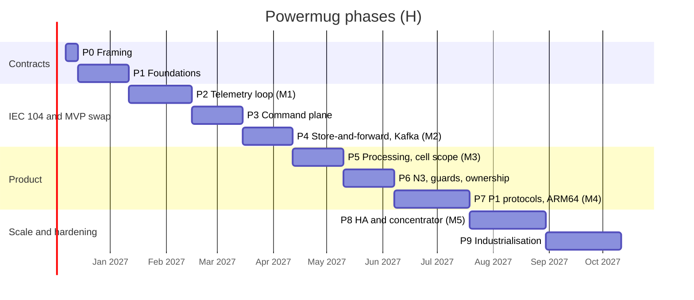

# Powermug — Implementation plan

Version 0.1 · 2026-11-19 · Draft for review

This plan delivers the gateway specified in [SPECIFICATIONS.md](SPECIFICATIONS.md) (referred to as [SPEC]). It cites the requirements of [SPEC] and of the gateway specification v0.5 ([GW]) by ID and does not repeat them.

---

## 1. Goals and assumptions

**Goal.** Replace FledgePower as the IBTNM target on the MVP bench as early as possible, then reach a pilot-ready product, then scale and harden it. Every phase delivers a vertical slice that works end to end ([GW] principle 13).

**Milestones:**

| Milestone | Meaning | End of phase |
|---|---|---|
| **M1 · Telemetry loop** | RTU → Powermug → SCADA in IEC 104, driven by signed revisions through the target API | P2 |
| **M2 · MVP target swap** | The IBTNM MVP scenarios that involve the target pass with Powermug in place of FledgePower (PM-ACC-011) | P4 |
| **M3 · Pilot-ready** | Processing, cell scope, catalogue integration; a first site can run Powermug on an edge or standalone profile, without HA ([GW] §17) | P5 |
| **M4 · Fleet-ready** | P1 protocols, ARM64, ownership transfer, shadow mode; multi-substation deployments | P7 |
| **M5 · Concentrator and HA** | Active/passive HA, several cells per host, 300-station load bench | P8 |

**Assumptions (H):**

- A team of two Rust engineers full time, plus a test and bench engineer at half time from P2 on. Durations below are calendar weeks for this team.
- The IGS protocol stacks are available as they are today: `igs-iec104` 0.1.x, `igs-iec61850-mms` 0.1.x, `igs-iso9506-mms` 1.2.x, `igs-iec-tase2` 1.1.x. Gaps found in them are fixed in their own repositories (§6).
- `igs-opcua` does not exist yet. The OPC UA adapters are scheduled after it and are not on the critical path.
- The gridloop repository (IBTNM engine, MVP bench) remains the integration environment, and changes to it are made by the same team (§6).
- Planned start: 2026-12-07 (H).

---

## 2. Strategy

1. **Contract first.** The pieces that other systems depend on come first and are frozen early:
   - the revision format, RFC 8785 identity and signed-plan verification (`powermug-revision`);
   - the pivot and adapter contracts.
   
   They are the hardest to change later and they let the gridloop driver be built in parallel.
2. **Walking skeleton.** A crash-isolated fake adapter talks to the core over the real contract before any protocol code is written. The sandbox and the supervisor exist from P1 on, so PM5 is never retrofitted.
3. **IEC 104 end to end before breadth.** The MVP is IEC 104 on both sides, plus Kafka. Powermug follows the same order, so the MVP bench can switch targets at M2.
4. **Measure from the start.** The load bench and the p99 gates exist from P2 on (PM17, PM-PERF-001). Optimizations come only from measurements.
5. **Every phase ends with acceptance criteria.** The criteria are ACC, PM-ACC or MVP scenarios, run in CI or on the bench, with campaign sizes reduced as allowed by [GW] §18.2.

---

## 3. Phase overview

| Phase | Content | Weeks (H) | Exit criteria | Milestone |
|---|---|---|---|---|
| P0 | Framing | 1 | Decisions recorded, bench ready | — |
| P1 | Foundations: workspace, contracts, revision crate, sandbox, supervisor | 4 | PM-ACC-002, PM-ACC-003, crash isolation on a fake adapter | — |
| P2 | IEC 104 telemetry loop, journal, image, target API | 5 | ACC-011, ACC-013, ACC-014, ACC-018, MVP S1, S15, S16 | M1 |
| P3 | Command plane | 4 | ACC-002, ACC-003, ACC-008, MVP S17, S18, S19 | — |
| P4 | Store-and-forward, Kafka, MQTT 5, indicators | 4 | ACC-001, ACC-007, ACC-015, ACC-023, PM-ACC-010, PM-ACC-011 | M2 |
| P5 | Processing N1 and N2, cell scope, catalogue integration | 4 | ACC-017, ACC-019, ACC-024, PM-ACC-001, 005, 006, 007, 012, 013 | M3 |
| P6 | Processing adapters N3, guards, ownership transfer, shadow mode | 4 | ACC-025, ACC-026, PM-ACC-008, PM-ACC-009 | — |
| P7 | P1 protocols, ARM64, fidelity matrices, PKI enrolment | 6 | ACC-010, ACC-022, PM-ACC-004 on every adapter kind, 50-station bench | M4 |
| P8 | High availability and concentrator scale | 6 | ACC-004, ACC-005, ACC-016, ACC-020, ACC-021 | M5 |
| P9 | Industrialisation | 6, then continuous | ACC-009, ACC-012, 30-day endurance | — |

Total to M5: 38 weeks (H); P9 takes 6 more weeks before it becomes continuous work.

---

## 4. Phases

### P0 · Framing (1 week)

**Goal.** Fix what the other phases depend on.

| Task | Output |
|---|---|
| Record ADR-13 to ADR-21 and the positions on ADR-01 to ADR-12 ([SPEC] §21) | `docs/adr/*.md` |
| Choose the development hardware: one x86_64 industrial PC, one ARM64 board | Hardware list in `docs/bench.md` |
| Confirm the kernel features on that hardware: cgroup v2 delegation, Landlock ABI version, seccomp | Feature report; decision on the nftables fallback ([SPEC] §6.4) |
| Inventory the features needed from `igs-iec104` (§6.1) and open the gaps in its backlog | Gap list |
| Set up the bench: the gridloop MVP environment, simulated RTUs, demo SCADA, Kafka | Bench reachable from CI |
| Agree the gridloop changes and their order with the IBTNM side (§6.2) | Change list with target phases |

**Exit.** ADRs merged; bench reachable; kernel feature report written.

### P1 · Foundations (4 weeks)

**Goal.** The contracts, the revision crate and a crash-isolated adapter, with no protocol yet.

| Area | Deliverables |
|---|---|
| Workspace and CI | Cargo workspace ([SPEC] §19); CI with `fmt`, `clippy -D warnings`, tests, `cargo-deny`, `buf lint` and `buf breaking`, builds for x86_64 and aarch64; ADR template; `#![forbid(unsafe_code)]` policy |
| `powermug-pivot` | `powermug.pivot.v1` Protobuf; Rust types; compact `PointEvent`; quality model ([SPEC] §5.2) |
| `powermug-contract` | `powermug.adapter.v1` services; handshake; credits; bounded messages (PM-ADP-002); UDS server with `SO_PEERCRED` check |
| `powermug-revision` | Strict YAML/JSON loader; RFC 8785 serializer; content ids; signed-plan verification ([SPEC] §10.6); revision types for `CellRevision` and `PartitionRevision` (first subset: sessions, points, routes, destinations); JSON Schema generation; validation stage 1 |
| Cross-language corpus | A gridloop script that generates 10,000 documents and their Python `rfc8785` bytes; a Rust test that compares them (PM-ACC-002); signed plans produced by gridloop's signing service as fixtures (PM-ACC-003) |
| `powermug` CLI | `revision hash`, `revision validate` (stage 1) |
| `powermug-sandbox` | Spawner role; namespaces; uid allocation; Landlock; seccomp allow-lists; cgroup v2 children (PM-PROC-001, 002, PM-ADP-005) |
| Supervisor | Lifecycle state machine ([SPEC] §6.2), restart budget, backoff, quarantine, health |
| `powermug-adapter-sdk` | Client side of the contract; session supervisor; sandbox entry point; fake core for tests |
| Fake adapter | `adapter fake` that emits events at a set rate and can be told to SIGSEGV, panic, leak memory or make a forbidden system call |

**Tests.**

- Property tests on RFC 8785 and on the strict loader.
- Fuzz targets on the loader and the contract decoder.
- Crash tests: each fault mode of the fake adapter leaves the core and a second fake adapter running.

**Exit.** PM-ACC-002 and PM-ACC-003 pass. The four fault modes of the fake adapter are confined (the PM-ACC-004 procedure on the fake adapter). `powermug revision validate` runs on a sample revision.

### P2 · IEC 104 telemetry loop (5 weeks) · M1

**Goal.** RTU → Powermug → SCADA in IEC 104, configured by signed revisions through the IBTNM target API.

| Area | Deliverables |
|---|---|
| `adapters/iec104` | `iec104-client` (controlling station) and `iec104-server` (controlled station) on `igs-iec104`; general interrogation; spontaneous and periodic data; quality mapping ([SPEC] §5.2); redundancy group with one active connection (PM-TEL-005); one common address per station |
| `powermug-core` data plane | Partition lanes; ingestion; telemetry writer with group commit; process image; image destination views; communication-loss propagation (PM-TEL-007); GI scheduling with concurrency cap ([SPEC] §7.7) |
| `powermug-store` | Telemetry log schema; snapshots; image rebuild at start (FUN-IMG-004); critical store with the `revisions` and `audit` tables only |
| Configuration | Validation stages 2–4 for the P2 subset; prepare, activate and rollback; generation pointer (PM-CFG-002, 005); change classes `HOT` and `SESSION_RESTART` |
| `powermug-mgmt` | Target API v1 (`/capabilities`, `/state`, `/revisions/*`, `/indicators` with a first subset); mTLS; health and readiness |
| Packaging | Containerfile; Quadlet template ([SPEC] §18.2); bench profile |
| gridloop | First `powermug.py` driver rendering partition revisions for S3 and validating through the CLI; `powermug@1` in `capabilities.json` (§6.2) |
| `powermug-bench` | Simulated RTUs and SCADA at configurable rates; latency histograms; first p99 gate in CI (PM-PERF-001) |

**Tests.**

- Session loss and recovery on both sides.
- GI after SCADA reconnection.
- Kill of the core during group commit, then restart.
- The same revision applied twice.

**Exit.**

- ACC-011, ACC-013, ACC-014 and ACC-018 pass.
- MVP S1 (commissioning, monitoring part), S15 (engine loss) and S16 (SCADA connection failover) pass with Powermug as the target.
- First NFR-PERF-002 and NFR-PERF-004 measurements are published.

### P3 · Command plane (4 weeks)

**Goal.** Commands from SCADA to RTU with every guarantee of [GW] §11.

| Area | Deliverables |
|---|---|
| `powermug-command` | FSM with transition table; critical store `commands`, `command_transitions`, `idempotency`; dedicated writer thread; recovery at start ([SPEC] §9.7) |
| Authorization | ACL per issuer, point, operation, value and mode; identity levels per protocol ([GW] §11.6); maintenance mode (FUN-OPS-006) |
| IEC 104 | Single and double commands, set points, direct execute and select-before-operate; time-tagged and untimed variants; bounded command TTL (PM-CAT-001) |
| Dispatch | Partition epochs from the cell revision's registry; epoch check in the South adapter (PM-CMD-005) |
| Audit | Hash-chained audit records (NFR-SEC-008) |
| Change classes | `COMMAND_CRITICAL`: block, drain and classify before activation (FUN-CMD-011) |

**Tests.**

- Fault injection between every pair of FSM states: kill the core, kill the South adapter, cut the RTU link.
- 10,000 resubmissions of the same `command_id` (reduced campaign).
- An unauthorized master.

**Exit.**

- ACC-002, ACC-003 and ACC-008 pass in reduced campaigns.
- MVP S17 (TC and TVC confirmed within 2 s), S18 (unauthorized issuer refused) and S19 (`IN_DOUBT` never replayed) pass.
- NFR-PERF-003 is measured.

### P4 · Store-and-forward, Kafka, MQTT 5, indicators (4 weeks) · M2

**Goal.** The flux side of the MVP and the indicators that IBTNM supervision consumes. At the end, the MVP bench runs on Powermug.

| Area | Deliverables |
|---|---|
| `adapters/kafka` | `kafka-producer` on `rdkafka`, as a separate executable; delivery acknowledgements mapped to cursors; mTLS or SASL from secret references |
| `adapters/mqtt5` | `mqtt5-client` (crate confirmed under NFR-MNT-003 at the start of the phase) |
| Delivery | Live ring; cursors; replay from the journal, marked and rate-capped; explicit start point (PM-TEL-004); image destination event buffers |
| Classes and saturation | Quotas per class; four thresholds; shedding of class C; separate volumes and quota check at start (PM-TEL-006) |
| Indicators | Every `indicators.v1` indicator that Powermug can measure ([SPEC] §11.3); OpenMetrics with bounded series |
| Local actions | `restart_adapter`, `shed_class_c`, `general_interrogation`, `switch_redundant_connection`, `alert`, `purge_tmp`; target API extension `/actions/execute` (§6.2) |
| Bench | MVP environment with Powermug in place of FledgePower: 11 simulated RTUs, demo SCADA with redundancy group, Kafka and historian |

**Tests.**

- 1,000 random power cuts on the bench VM (reduced campaign).
- Full telemetry quota.
- Long North disconnection.
- Telemetry flood at 120 % with commands.

**Exit.**

- ACC-001, ACC-007, ACC-015 and ACC-023 pass. PM-ACC-010 passes.
- **PM-ACC-011**: the MVP scenarios S1, S6, S7 and S14 to S19 pass with Powermug.
- S8 (R1 remediation through `purge_tmp`) also passes.

### P5 · Processing N1 and N2, cell scope, catalogue integration (4 weeks) · M3

**Goal.** The processing model of [SPEC] §8, levels N1 and N2, and full integration with the instantiation assistant.

| Area | Deliverables |
|---|---|
| `powermug-process` | N1 catalogue ([SPEC] §8.2) with quality declarations; chain compiler; ingress and route chains; `engineering` parameters; overrides; named chains; `enabled` flag |
| Cycle supervision | `cycle_check` with timing wheel and the state machine of [SPEC] §7.8; North time-tag option |
| Replay determinism | Compiled chains kept per revision while referenced (PM-EXT-007) |
| CEL | `ExprEngine` on `cel-interpreter`; domain functions `expr.cel.v1`; static cost bound; calculated points (ADR-21 confirmed against the CEL conformance tests) |
| Validation | Graph checks (PM-GRF-001); image-route drop rule (PM-EXT-008); quality-change declarations (PM-EXT-002) |
| CLI | `revision diff`, `revision preview`, `revision build`, `revision sign` |
| Cell scope | `CellRevision` with shared North modules and the partition registry; generations (ADR-19) |
| Catalogue | `powermug catalog export` ([SPEC] §11.5) |
| gridloop | Catalogue rename `igs-gateway@1` → `powermug@1`; target revision schema 1.2.0; driver support for the cell scope (`CELL_DC1`) (§6.2) |

**Tests.**

- The use-case corpus of the *Powermug Use Cases* page: cycling check, transformation, range filter, per-destination specialization.
- The refusal corpus for `PMV-*` codes.
- Core and CLI findings parity on 200 revisions.

**Exit.**

- ACC-017, ACC-019 and ACC-024 pass.
- PM-ACC-001, PM-ACC-005, PM-ACC-006 and PM-ACC-007 pass.
- **PM-ACC-012** (S3 and `CELL_DC1` resolve on `powermug@1`) and **PM-ACC-013** (11 partitions behind one IEC 104 redundancy group) pass.
- Pilot readiness review held.

### P6 · Processing adapters, guards, ownership transfer, shadow mode (4 weeks)

**Goal.** Level N3, the command guards, and the mechanisms needed to migrate partitions between cells and from FledgePower.

| Area | Deliverables |
|---|---|
| N3 | `processor` role in the handshake; `stream` and `snapshot` input modes; derived and own points; write ownership checks (PM-N3-001); rate cap; provenance; `enabled: false` and `mode: shadow` |
| Reference processor | `processors/state-estimator`: a prototype WLS estimator on a small network model, used to qualify N3, not a product feature ([SPEC] §8.7) |
| Guards | Deny-only CEL guards on commands (ADR-14, PM-CMD-006) |
| Ownership | Cession and takeover with signed proofs and epochs; refusal of commands during transfer; `/ownership/*` endpoints ([SPEC] §11.7) |
| Shadow mode | Read-only acquisition and comparison destination (FUN-MGT-010) |
| Local actions | `quarantine_processor` |
| FledgePower takeover | The procedure of [SPEC] §11.8, run on the bench for S3 with the FledgePower driver's cession procedure |

**Tests.**

- A processor crashing or overrunning its period.
- An undeclared write.
- A command aimed at a processor point.
- A transfer interrupted at each step.
- Shadow mode with a production destination declared by mistake (refused).

**Exit.**

- ACC-025 and ACC-026 pass. PM-ACC-008 and PM-ACC-009 pass.
- The S3 partition is migrated from FledgePower to Powermug on the bench with no instant of two command paths.

### P7 · P1 protocols, ARM64, fidelity, PKI (6 weeks) · M4

**Goal.** The P1 protocols and portability.

| Area | Deliverables |
|---|---|
| `adapters/iec61850-mms` | `iec61850-mms-client` on `igs-iec61850-mms`: reports, polling, controls with SBO and enhanced security |
| `adapters/modbus` | TCP and RTU polling master (crate confirmed under NFR-MNT-003) |
| `adapters/opcua` | Client and server on `igs-opcua` **if the library is available**; otherwise moved to P9 without affecting M4 |
| Fidelity | One matrix per adapter kind; round-trip corpus `protocol → pivot → same protocol` ([GW] §9.4) |
| Portability | Full test suite on ARM64; multi-arch images (NFR-PORT-001) |
| PKI | EST enrolment and staggered rotation; trust store rotation with overlap (PM-SIG-001) |
| Bench | 50 simulated stations, mixed protocols |

**Exit.**

- ACC-010 passes.
- ACC-022 (72 h without the management system, on the 50-station bench) passes.
- ACC-023 is confirmed at scale.
- PM-ACC-004 passes for every adapter kind delivered.

### P8 · High availability and concentrator scale (6 weeks) · M5

**Goal.** [GW] §13 and the concentrator profile.

| Area | Deliverables |
|---|---|
| HA | OCF resource agent `powermug-cell`; role API; promotion conditions; DRBD for the critical volume; single-copy continuation and `HA_SINGLE_COPY`; no automatic failback |
| Pool | Lease and watchdog self-fencing prototype, behind ADR-08, for pools beyond about ten nodes |
| Concentrator | Several cells per host; per-cell uid ranges, volumes and cgroups; deployment profile `concentrator` |
| Aggregation | ADR-09 decided with the correlated-peak bench; flux destination to the chosen bus |
| Bench | 300 simulated stations (H); correlated peak scenario (20 % of stations at once); GI storms |

**Exit.** ACC-004, ACC-005 and ACC-016 pass (reduced campaigns). ACC-020 (resynchronization within the RTO) and ACC-021 (correlated peak without class A loss or command p99 breach) pass.

### P9 · Industrialisation (6 weeks, then continuous)

| Area | Deliverables |
|---|---|
| Supply chain | Signed releases; CycloneDX SBOM; provenance attestation; CVE policy (NFR-SEC-004, 005, NFR-PORT-003) |
| Continuous testing | Continuous fuzzing; HIL benches per hardware reference; 30-day endurance for major releases |
| OS | Yocto (or equivalent) image with RAUC or SWUpdate A/B (ADR-07) |
| Observability | OpenTelemetry traces for commands and errors |
| Protocols | TASE.2 on `igs-iec-tase2`; OPC UA if moved from P7; other P2 protocols on demand |
| Compliance | IEC 62443, IEC 62351 and ANSSI matrix (NFR-SEC-010) |

**Exit.** ACC-009 (100 non-bootable updates roll back) and ACC-012 (full rebuild from documented operations) pass. A first major-release campaign with the full volumes of [GW] §18.2 is completed.

---

## 5. Cross-cutting workstreams

| Workstream | From | Content |
|---|---|---|
| Quality gates | P1 | `fmt`, `clippy`, tests, `cargo-deny`, `buf breaking`, schema diff, `unsafe` policy; required on every merge |
| Fuzzing | P1 | Loader, contract decoder, API; protocol codecs through the IGS stacks' own fuzz targets; corpus kept in `fuzz/` |
| Performance | P2 | `criterion` microbenchmarks; `powermug-bench` reduced scenario on every merge; full campaign per phase; p99 regression gate (PM-PERF-001) |
| Fault injection | P1 | Fake adapter faults, process kills, power cuts, disk full, `tc netem`, clock loss; scripted and replayable |
| Security | P1 | Threat model updated per phase, including the management API; sandbox profiles reviewed with each new adapter kind |
| Documentation | P0 | ADRs; fidelity matrices; OpenAPI; revision schema; operator guide from P4; [SPEC] kept in step with the code |
| Conformance | P2 | gridloop conformance kit against the target API; MVP scenarios replayed from P4 on |

---

## 6. External dependencies

### 6.1 IGS protocol stacks

| Library | Needed for | Features to confirm in P0 | Needed by |
|---|---|---|---|
| `igs-iec104` | P0 adapters | Controlling and controlled station roles; GI; time-tagged ASDUs; SBO; redundancy group (several connections, one active after `STARTDT`); IEC 62351-3 TLS; window and timeout settings | P2 (monitoring), P3 (commands) |
| `igs-iec61850-mms` / `igs-iso9506-mms` | MMS client | Buffered and unbuffered reports; polling; SBO with enhanced security; dataset browsing | P7 |
| `igs-iec-tase2` | TASE.2 | Server and client roles; data value quality mapping; transfer sets | P9 |
| `igs-opcua` | OPC UA client and server | **Library to be developed**: subscriptions, methods, server address space, security policies | P7 if available, otherwise P9 |

Gaps found are fixed in the library's repository, released, then pinned in Powermug's workspace.

### 6.2 gridloop (IBTNM engine and MVP bench)

| Change | [SPEC] | Needed by |
|---|---|---|
| `powermug@1` profile in `catalogs/capabilities.json` | §11.2, §23 | P2 |
| `src/ibtnm/drivers/powermug.py`: partition revisions, validation through the CLI | §11.6 | P2 |
| Cross-language RFC 8785 corpus and signed-plan fixtures | §10.6, PM-ACC-002, 003 | P1 |
| Target API v1.1: `/actions/execute`, `/actions/rollback`, `/revisions/remove` | §11.1 | P4 |
| MVP bench profile with Powermug as the target | PM-ACC-011 | P4 |
| `indicators.json` v2 | §11.3 | P4 (proposal), P5 (adoption) |
| `catalogs/gateway-modules.json`: `igs-gateway@1` → `powermug@1`, generated entries | §11.5, §23 | P5 |
| `target-revision.schema.json` 1.2.0 (`scope`, `target_configuration` variants) | §10.1, §23 | P5 |
| Driver support for the cell scope (`CELL_DC1`) | §10.2 | P5 |
| Target API v1.1: `/ownership/*` | §11.7 | P6 |
| [AST] text updates | §23 | P5 |

---

## 7. Requirement coverage by phase

| Phase | [GW] requirements implemented | Acceptance |
|---|---|---|
| P1 | FUN-ACQ-001, 002, 005, 007, 008; FUN-PIV-001 to 004, 011; FUN-CFG-001, 003; NFR-MNT-002; NFR-SEC-009 | PM-ACC-002, 003 |
| P2 | FUN-ACQ-003, 004, 006, 009, 010; FUN-IMG-001 to 004; FUN-CFG-004 to 008; FUN-MGT-001 to 003, 006, 008; FUN-SCA-001 to 005; FUN-OPS-001, 005; NFR-TIME-001 to 004 | ACC-011, 013, 014, 018 |
| P3 | FUN-CMD-001 to 011; FUN-OPS-002, 006; FUN-CFG-007 (`COMMAND_CRITICAL`); NFR-SEC-008 | ACC-002, 003, 008 |
| P4 | FUN-SAF-001 to 010; FUN-MGT-005, 007; NFR-PERF-001 to 008; NFR-SCA-005 | ACC-001, 007, 015, 023; PM-ACC-010, 011 |
| P5 | FUN-PIV-005 to 010; FUN-CFG-009 (prepared passive, groundwork), 010, 011; FUN-MGT-004; FUN-SCA-010; INST-011, 013, 014, 016, 027, 028 | ACC-017, 019, 024; PM-ACC-001, 005, 006, 007, 012, 013 |
| P6 | FUN-CMD-012; FUN-MGT-009, 010; FUN-EW-* (peer adapter, if scheduled); ENG-016 | ACC-025, 026; PM-ACC-008, 009 |
| P7 | NFR-PORT-001, 002; [GW] §9.4 fidelity; [GW] §15.11 PKI | ACC-010, 022; PM-ACC-004 |
| P8 | FUN-CFG-009; FUN-IMG-005; NFR-RES-003 to 008; NFR-SCA-003, 004; FUN-SCA-006 to 009 | ACC-004, 005, 016, 020, 021 |
| P9 | NFR-SEC-004 to 007, 010; NFR-PORT-003; [GW] §15.8 | ACC-009, 012 |

ACC-006 (PTP loss) is tested from P2 on with a simulated clock source, and on real PTP hardware in P7.

---

## 8. Risks

| Risk | Impact | Measure | Phase |
|---|---|---|---|
| `igs-iec104` lacks a feature needed by the MVP (redundancy group, SBO, TLS) | M1 or M2 slips | Gap inventory in P0; fixes in the library before P2 and P3; bench tests against an independent peer | P0–P3 |
| cgroup v2 delegation or Landlock not available on the target kernel | PM5 cannot be enforced in production | Feature report in P0; nftables fallback for network; refuse production start without the required features (PM-ADP-005) | P0–P1 |
| RFC 8785 mismatch between Rust and Python | Revisions refused by the cell or ids that differ from IBTNM's | Cross-language corpus from P1 (PM-ACC-002), run in both repositories' CI | P1 |
| SQLite single writer below 2× nominal at concentrator scale | Cell size smaller than planned | Measure from P2; tune group commit; RocksDB behind the `TelemetryLog` trait only if needed; split cells otherwise | P2–P8 |
| gRPC over UDS too costly on the hot path | NFR-PERF-004 missed | Batching from P1; measure in P2; length-delimited Protobuf or shared memory on the hot path only ([GW] §8.4) | P2–P4 |
| `cel-interpreter` incomplete or not conformant | N2 limited | Conformance tests at the start of P5; the `ExprEngine` trait allows a replacement | P5 |
| `igs-opcua` late | OPC UA not in M4 | OPC UA not on the critical path; moved to P9 | P7 |
| Rust learning curve on the team | Slower phases | Contract-first order; pairing on the FSM and the store; reviews focused on `unsafe` and concurrency | All |
| gridloop changes not ready when needed | Integration milestones slip | Changes listed per phase (§6.2); made by the same team | P2–P6 |
| Scope larger than the team | Late phases not delivered | Milestones M2 and M3 deliver value on their own; P7 to P9 can be re-planned after M3 | All |

---

## 9. Definition of done

A phase is done when:

1. Its exit criteria pass in CI or on the bench, and the report (with p50, p95, p99, p99.9 and max where performance is involved) is stored in `docs/reports/`.
2. Every new requirement it implements has at least one test that names the requirement ID.
3. No new `clippy`, `cargo-deny` or `buf breaking` finding, and no unjustified `unsafe` block.
4. The revision schema, the OpenAPI document and the fidelity matrices are regenerated and committed.
5. [SPEC] is updated where the implementation made a decision the specification left open, with an ADR when the decision is architectural.
6. The release notes list the capabilities whose version changed.

---

## 10. First two weeks

1. Merge the ADR files and the bench description (P0).
2. Create the workspace with `powermug-pivot`, `powermug-contract`, `powermug-revision` and the `powermug` binary, and set up CI with all quality gates.
3. Write the RFC 8785 serializer with the RFC vectors, then the gridloop corpus script and the comparison test.
4. Implement signed-plan verification against fixtures produced by gridloop's signing service.
5. Write the spawner and the fake adapter, and prove the four fault modes are confined.
