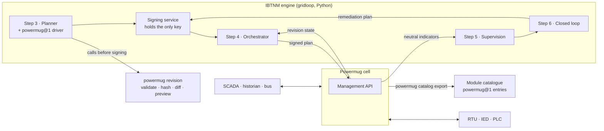
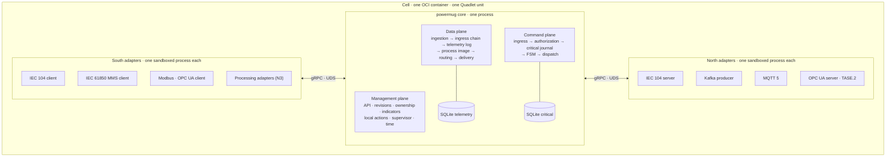
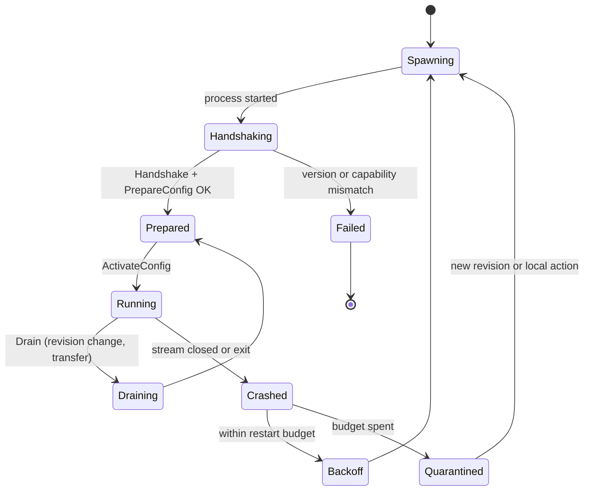
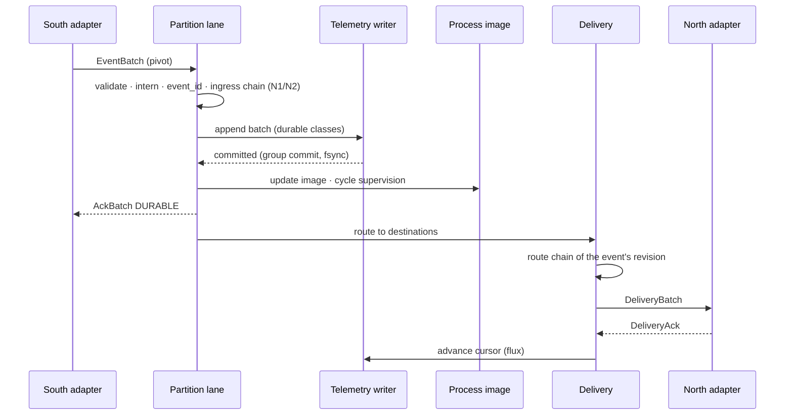

# Powermug — Specification

Version 0.1 · 2026-11-19 · Draft for review

Powermug is a protocol translation gateway for power-system telecontrol (SCADA, RTU, IED), written in Rust. It is built from scratch: no code from Fledge or FledgePower is reused. This document specifies its architecture and its implementation. The delivery plan is in [IMPLEMENTATION.md](IMPLEMENTATION.md).

Two companion pages illustrate this document; the specification is the reference when they differ:

- *Powermug Architecture*: the cell, its place in the IBTNM chain, the adapter crash sequence.
- *Powermug Use Cases*: TM cycling check, transformation, range filter, state estimator, chaining and per-destination specialization.

---

## Contents

1. [Purpose and scope](#1-purpose-and-scope)
2. [Principles](#2-principles)
3. [Context: Powermug in the IBTNM chain](#3-context-powermug-in-the-ibtnm-chain)
4. [Architecture overview](#4-architecture-overview)
5. [Pivot data model](#5-pivot-data-model)
6. [Adapters](#6-adapters)
7. [Telemetry pipeline](#7-telemetry-pipeline)
8. [Processing and extensibility](#8-processing-and-extensibility)
9. [Command plane](#9-command-plane)
10. [Revisions and configuration](#10-revisions-and-configuration)
11. [Management contract and IBTNM integration](#11-management-contract-and-ibtnm-integration)
12. [Scalability](#12-scalability)
13. [Performance](#13-performance)
14. [High availability](#14-high-availability)
15. [Security](#15-security)
16. [Time](#16-time)
17. [Observability and diagnostics](#17-observability-and-diagnostics)
18. [Packaging and deployment](#18-packaging-and-deployment)
19. [Code organisation](#19-code-organisation)
20. [Testing and qualification](#20-testing-and-qualification)
21. [Architecture decisions](#21-architecture-decisions)
22. [Traceability matrix](#22-traceability-matrix)
23. [Changes required in linked documents](#23-changes-required-in-linked-documents)
24. [Open questions](#24-open-questions)
25. [Glossary](#25-glossary)

---

## 1. Purpose and scope

### 1.1 What Powermug is

Powermug acquires data from field devices (RTU, IED, PLC) over South protocols. It normalizes the data into a pivot model, keeps a process image and a durable journal, and serves the data to upstream systems (SCADA, historians, data buses) over North protocols. It carries commands from SCADA to the field, with authorization, persistence and an explicit state machine.

Powermug is the implementation of the telecontrol gateway specification v0.5. Within the IBTNM chain it is a **target** with profile **`powermug@1`**: it applies signed revisions, exposes capabilities and neutral indicators, and knows nothing about intents.

### 1.2 Reference documents

| Ref | Document | Version | Role for Powermug |
|---|---|---|---|
| [GW] | Spécification fonctionnelle, d'architecture et d'implémentation d'une passerelle de téléconduite (`SPECIFICATION_PASSERELLE_TELECONDUITE_v0.5.md`) | 0.5 | Functional and non-functional requirements. Powermug implements them; this document cites them by ID and does not repeat them. |
| [IBTNM] | IBTNM — Principes directeurs et spécification du moteur d'intentions | Sep 2026 | Principles P1–P13 and requirements ENG-001 to ENG-034 that apply to targets. |
| [AST] | Spécification de l'assistant d'instanciation de passerelle (`SPECIFICATION_ASSISTANT_INSTANCIATION_v0.1.md`, with the v0.2 cell scope) | 0.1 / 0.2 | Module catalogue, target profiles, instantiation rules INST-xxx. |
| [MVP] | Plan d'implémentation du MVP IBTNM — chaîne en six étapes | Sep 2026 | Demonstration scenarios S1–S19 that Powermug must pass in place of FledgePower. |
| [ICD] | gridloop contract files: `schemas/target-api-v1.yaml`, `schemas/signed-plan.schema.json`, `schemas/target-revision.schema.json`, `catalogs/capabilities.json`, `catalogs/indicators.json`, `catalogs/gateway-modules.json` | As of 2026-11-19 | The concrete management contract. Powermug implements it byte for byte. |

### 1.3 Conventions

- MUST, MUST NOT, SHOULD, MAY: as in RFC 2119.
- A value followed by (H) is a sizing hypothesis, to be confirmed by measurement.
- `FUN-*`, `NFR-*`, `ACC-*`, `ADR-01` to `ADR-12`: requirements and decisions of [GW].
- `ENG-*`, `P1` to `P13`: requirements and principles of [IBTNM].
- `INST-*`, `AST-*`, `ACC-AST-*`: rules and requirements of [AST].
- `PM-*`: Powermug requirements introduced by this document. `PM-ACC-*`: Powermug acceptance criteria. `ADR-13` and above: Powermug decisions (§21).
- `PMV-*`: revision validation codes emitted by Powermug (§10.4).

### 1.4 Scope

In scope: everything in [GW] §3.1, with the protocol priorities of §6.7.

Out of scope: [GW] §3.3 applies, with one deliberate change. Processing adapters (§8.5) relax the exclusion of "third-party transformation plugins" for first-party, signed, out-of-process modules (ADR-13).

Explicitly excluded: any reuse of Fledge or FledgePower code, plugin ABI, configuration format or storage layout. FledgePower remains a separate IBTNM target (`ibtnm-fledgepower@1`), and Powermug must be able to take over its partitions (§11.8).

---

## 2. Principles

Seventeen principles govern Powermug. Each requirement of this document traces to at least one of them.

| # | Principle | What it implies | Traces to |
|---|---|---|---|
| PM1 | **A target, nothing more.** | Powermug applies any valid signed revision, whatever produced it. It stores upstream provenance, echoes it back, and never reads it. It has no notion of intent. | P9, P12, [GW] principle 15, FUN-MGT-002 |
| PM2 | **Signed or refused.** | No configuration takes effect without a valid signature from an authorized key. The cell never holds a signing key. | ENG-013, FUN-CFG-001, NFR-SEC-003 |
| PM3 | **One validator.** | The core, the `powermug` CLI and the IBTNM `powermug@1` driver use the same validation code (`powermug-revision` crate). A revision accepted before signing is accepted by the cell. | P4, P5, FUN-PIV-009 |
| PM4 | **Refuse rather than adapt silently.** | A missing value is an error, never a default. An unknown field is an error. A value that cannot be computed is sent as invalid, never passed through raw. | P6 |
| PM5 | **A crash stays where it happens.** | Each adapter instance is a separate, sandboxed process. A crash, a panic or an out-of-memory kill never stops the core or another adapter. | FUN-ACQ-001, FUN-ACQ-002, ACC-011 |
| PM6 | **Modular monolith, three planes.** | One core process, with the data, command and management planes on separate runtimes, queues and stores. | [GW] principle 3, §7.3 |
| PM7 | **The command path is protected.** | Commands are persisted before they are acknowledged. They are never replayed automatically. Extension code never creates or changes a command. | P13, FUN-CMD-*, ENG-025 |
| PM8 | **Everything is bounded.** | Queues, batches, retries, restarts, memory, disk, expression cost and chain length all have explicit limits. Saturation leads to a declared behaviour. | FUN-ACQ-005, FUN-SAF-008, NFR-RES-007 |
| PM9 | **Critical state is apart.** | Commands, audit and configuration live in a store and on a volume that telemetry cannot fill. | [GW] principle 7, ACC-007 |
| PM10 | **Each consumer gets its own semantics.** | Flux destinations get a replayable stream. Image destinations get a process image that can be resynchronized. | [GW] principle 11, FUN-SAF-010 |
| PM11 | **Quality never lies.** | A value whose source is lost, stale or unverifiable is degraded within a bounded time, on every destination. | FUN-ACQ-009, FUN-IMG-004 |
| PM12 | **Scale by adding cells.** | A cell owns its partitions exclusively and shares no state. More load means more cells, never a distributed cell. | [GW] principle 14, FUN-SCA-* |
| PM13 | **Closed extension.** | Processing comes from three levels only: the core catalogue (N1), CEL expressions (N2) and signed processing adapters (N3). No third-party code runs in the core process. | FUN-PIV-009, NFR-MNT-002, ADR-13 |
| PM14 | **Neutral, bounded observability.** | Indicators follow the IBTNM catalogue. The number of metric series does not depend on the number of points. | FUN-MGT-005, NFR-SCA-005 |
| PM15 | **Crash-only.** | Every start is a recovery from the journals. There is no separate clean-shutdown path to maintain. | NFR-RES-002, FUN-IMG-004 |
| PM16 | **One binary, one format, one unit.** | A single `powermug` binary with roles, one revision format and one Quadlet unit per cell. Deploying a site means copying an image and a revision. | Ease of deployment goal, [GW] §15.7 |
| PM17 | **Measure before complicating.** | Performance budgets are checked in CI. Optimizations such as shared memory, RocksDB or CPU pinning are added only after a measured need. | [GW] principle 9, NFR-PERF-007 |

---

## 3. Context: Powermug in the IBTNM chain



| Interaction | Direction | Content | Contract |
|---|---|---|---|
| Revision application | Orchestrator → cell | Signed plan envelope and revision id | `POST /revisions/prepare`, `/activate`, `/rollback` (§11.1) |
| State | Cell → orchestrator | Active, prepared and previous revisions per scope | `GET /state`, `GET /revisions/{id}` |
| Capabilities | Cell → planner, driver | Capability ids, versions, limits | `GET /capabilities` (§11.2) |
| Indicators | Cell → supervision | Neutral, timestamped indicators | `GET /indicators`, OpenMetrics (§11.3) |
| Remediation actions | Orchestrator → cell | Signed R1/R2 actions from the local catalogue | `POST /actions/execute` (§11.4) |
| Validation | Driver → CLI | Revision document, result in canonical JSON | `powermug revision validate` (§10.7) |
| Catalogue | Powermug release → [AST] catalogue | Function implementations for `powermug@1` | `powermug catalog export` (§11.5) |
| Telemetry and commands | SCADA, devices ↔ cell | Protocol traffic | North and South adapters (§6) |

The engine is never on the data path. Stopping the whole engine leaves acquisition, commands and the active configuration intact (ENG-017, FUN-MGT-008, NFR-RES-001, MVP scenario S15).

---

## 4. Architecture overview

### 4.1 The cell

A **cell** is one complete Powermug runtime: the core, its adapters, its two stores and its process image. A **partition** is a set of South sessions and their points, usually one substation (`site_id`). Each partition belongs to exactly one cell (FUN-SCA-001).



### 4.2 Processes

All processes run from the same binary, `powermug`, in different roles.

| Role | Command | Privileges | Count per cell |
|---|---|---|---|
| Core | `powermug core --cell <dir>` | No Linux capabilities after start | 1 |
| Spawner | `powermug spawner` (forked by the core at start) | `CAP_SETUID`, `CAP_SETGID` only; no network, no store access | 1 |
| Adapter | `powermug adapter <kind>` | Its own uid and gid; sandbox of §6.4 | 1 per adapter instance |
| Processor | `powermug adapter processor:<kind>`, or a separate signed binary built on the SDK | Same as an adapter | 1 per processor instance |
| CLI | `powermug revision …`, `powermug catalog …`, `powermug diag …` | Runs outside the cell | — |

**PM-PROC-001.** The core MUST start each adapter instance as a separate process through the spawner, and MUST NOT load protocol libraries or third-party code in its own address space (FUN-ACQ-001, NFR-MNT-002).

**PM-PROC-002.** The core MUST drop all Linux capabilities once the spawner is started. Only the spawner keeps `CAP_SETUID` and `CAP_SETGID`. It accepts a single request type over a socket pair, "spawn adapter instance X with sandbox profile Y", and refuses any other.

**PM-PROC-003.** If the core dies, systemd restarts the whole cell (the Quadlet unit). Adapters die with it: they run in the core's PID namespace and receive `PR_SET_PDEATHSIG`. A restart is a recovery from the journals (PM15).

### 4.3 Planes

| Plane | Purpose | Runtime | Store | Guarantee |
|---|---|---|---|---|
| Data | Telemetry: ingestion, journal, image, routing, delivery | Tokio multi-thread runtime `data`, N workers (default: cores − 2, min 1) | Telemetry store | At least once per flux destination; latest consistent state per image destination |
| Command | Commands: authorization, journal, FSM, dispatch | Tokio runtime `cmd`, 2 dedicated workers, plus 1 dedicated thread for the critical store writer | Critical store | Persist before acknowledgement; one owner; never replayed |
| Management | API, revisions, ownership, indicators, supervision, time, local actions | Tokio runtime `mgmt`, 1–2 workers | Critical store (configuration and audit tables) | Off the nominal path |

**PM-PLANE-001.** The three planes MUST use separate runtimes and separate bounded queues. The command runtime MUST NOT share worker threads with the data runtime. A data-plane overload MUST NOT delay the command path beyond NFR-PERF-005.

**PM-PLANE-002.** Blocking or FFI work (SQLite, filesystem) MUST run on dedicated threads with bounded input queues, never on async workers ([GW] §15.3).

### 4.4 Core modules

| Module | Crate | Responsibility | [GW] §7.2 |
|---|---|---|---|
| `ingestion` | `powermug-core` | Envelope validation, source deduplication, `event_id` (UUIDv7), revision stamps, point interning | `ingestion` |
| `pivot` | `powermug-pivot` | Canonical types, Protobuf schemas, compact internal representation | `pivot` |
| `chain` | `powermug-process` | Ingress and route chains: N1 catalogue and N2 CEL evaluator | `transform` |
| `supervision` | `powermug-process` | Cycle check (§7.8), quality inheritance for derived points | (new) |
| `telemetry_log` | `powermug-store` | Append-only journal, group commit, retention, cursors, image snapshots | `telemetry_log` |
| `process_image` | `powermug-core` | Last value, quality and time per point; communication-loss propagation; general interrogation answers | `process_image` |
| `routing` | `powermug-core` | Routes by partition, group, point, class and destination | `routing` |
| `delivery` | `powermug-core` | Live fan-out, cursors, retry, catch-up, image destination views and buffers | `delivery` |
| `command` | `powermug-command` | Authorization, interlock guards, critical journal, FSM, dispatch, reconciliation | `command` |
| `config` | `powermug-revision`, `powermug-core` | Signature check, validation, prepare, activate, rollback, change classes | `config` |
| `ownership` | `powermug-core` | Partition registry, epochs, cession and takeover, shadow mode | (from §12.9) |
| `time` | `powermug-core` | Clock quality, degradation policy | `time` |
| `supervisor` | `powermug-core` | Adapter lifecycle, sandbox profiles, restart budgets, quarantine | `plugin_supervisor` |
| `api` | `powermug-mgmt` | REST management API, web UI static assets | `api` |
| `observability` | `powermug-mgmt` | Indicators, OpenMetrics, logs, audit chain, support bundle | `observability` |

These modules stay inside one binary. A module becomes a separate process only for a security, availability or lifecycle reason ([GW] §7.2).

### 4.5 Partition lanes

The data plane is sharded by partition. Each partition has one **lane**: a Tokio task that owns that partition's state (points, cycle deadlines, image slice) and processes its events in arrival order. Lanes are spread over the data workers.

- Order is preserved per partition, so per point.
- Lanes do not share mutable state, so the hot path takes no locks.
- A slow partition cannot block another one beyond the shared resources: the telemetry writer and the worker threads.

---

## 5. Pivot data model

### 5.1 Schemas

The pivot is defined in Protobuf, in package `powermug.pivot.v1` (FUN-PIV-001). Messages follow the families of [GW] §9.1: `StatusEvent`, `AnalogMeasurement`, `CounterEvent`, `AlarmEvent`, `SequenceOfEvents`, `CommunicationState`, `CommandRequest`, `CommandResult`, `TimeStatus`, `ConfigurationEvent`.

The common envelope carries every field of [GW] §9.2, with the following Powermug choices:

| Field | Powermug representation |
|---|---|
| `event_id` | UUIDv7, assigned by the core before the `DURABLE` acknowledgement (FUN-SAF-001) |
| `site_id`, `point_id` | Constrained strings; `point_id` prefixed by `site_id` (FUN-SCA-010), for example `S3/TM_001` |
| `value` | `oneof` of bool, int64, uint64, double, enum (u32 with a declared mapping), bitstring (≤ 64 bits), bounded text (≤ 256 bytes) (FUN-PIV-002) |
| `quality` | §5.2 |
| `source_time`, `receive_time`, `process_time` | Nanoseconds since the Unix epoch, plus a `time_quality` message (NFR-TIME-004) |
| `config_revision` | Configuration generation hash (§10.2) |
| `mapping_revision` | Id of the partition revision that mapped the point |
| `provenance` | Bounded list (≤ 16) of `step@revision` entries (FUN-PIV-005) |
| `origin_gateway_id`, `hop_count` | Present from v1 (FUN-PIV-011) |
| `native_extension` | `google.protobuf.Any`, ≤ 1 KiB, namespaced by adapter kind (FUN-PIV-004) |

**PM-PIV-001.** On the hot path the core MUST work on a compact internal representation (`PointEvent`). It holds:

- a point index (`u32`, interned at activation);
- the value as a tagged union;
- the quality as a bit field;
- three `i64` timestamps;
- the event id;
- a revision index.

Protobuf encoding happens only at process boundaries and in the journal.

### 5.2 Quality

The normalized quality follows the IEC 61850 quality structure, which can carry the other protocols without loss:

| Part | Values |
|---|---|
| `validity` | `good`, `invalid`, `questionable` |
| `detail` (set) | `overflow`, `out_of_range`, `bad_reference`, `oscillatory`, `failure`, `old_data`, `inconsistent`, `inaccurate` |
| `source` | `process`, `substituted` |
| `test`, `operator_blocked` | Booleans |
| `disabled` | Boolean, Powermug extension: set when the producing processor is disabled (§8.6) |

Each adapter declares the mapping between normalized and native quality in its fidelity matrix ([GW] §9.4, §10.7). The default mappings:

| Normalized | IEC 104 (QDS) | IEC 61850 | OPC UA | TASE.2 |
|---|---|---|---|---|
| `good` | all flags 0 | `validity=good` | `Good` | `VALID` |
| `invalid` | `IV=1` | `validity=invalid` | `Bad` | `NOTVALID` |
| `questionable` + `old_data` | `NT=1` | `validity=questionable`, `oldData` | `UncertainLastUsableValue` | `HELD` |
| `questionable` (other) | `NT=1` | `validity=questionable` | `Uncertain` | `SUSPECT` |
| `substituted` | `SB=1` | `source=substituted` | `GoodLocalOverride` | `CurrentSource=ENTERED` |
| `overflow` | `OV=1` | `detail.overflow` | `UncertainEngineeringUnitsExceeded` | `SUSPECT` |
| `operator_blocked` | `BL=1` | `operatorBlocked` | — | — |

A lossy mapping is declared in the matrix and produces a diagnostic counter (FUN-PIV-006).

### 5.3 Evolution

[GW] §9.3 applies. In addition:

**PM-PIV-002.** The `powermug-pivot` crate MUST contain a test that checks every Protobuf file against the previous released version, with `buf breaking` or an equivalent, and fails the build on an unannounced breaking change.

**PM-PIV-003.** The journal MUST store events with the schema version they were written with. A reader MUST decode old events with their historical schema and MUST NOT silently apply the current mapping (FUN-PIV-007).

---

## 6. Adapters

### 6.1 Contract

The adapter contract is the gRPC package `powermug.adapter.v1`, served by the core on one Unix domain socket per adapter instance ([GW] §8.2, §8.4).

```protobuf
service AdapterControl {
  rpc Handshake(HandshakeRequest) returns (HandshakeResponse);  // capabilities, versions
  rpc ValidateConfig(AdapterConfig) returns (ValidationReport);
  rpc PrepareConfig(AdapterConfig) returns (PrepareResult);    // no field effect
  rpc ActivateConfig(ActivateRequest) returns (ActivateResult);
  rpc Deactivate(DeactivateRequest) returns (DeactivateResult);
  rpc Drain(DrainRequest) returns (DrainResult);
  rpc Health(HealthRequest) returns (HealthReport);
}

service AdapterData {
  // South and processors: events to the core; the core returns acks.
  rpc StreamEvents(stream EventBatch) returns (stream AckBatch);
  // North and processors: events from the core; the adapter returns acks.
  rpc PublishEvents(stream DeliveryAck) returns (stream DeliveryBatch);
  // North: commands to the core. South: commands from the core.
  rpc SubmitCommands(stream CommandRequest) returns (stream CommandUpdate);
  rpc ExecuteCommands(stream CommandUpdate) returns (stream CommandDispatch);
  rpc RecoverCommand(RecoverRequest) returns (RecoverResult);
  rpc InterrogateState(InterrogateRequest) returns (InterrogateResult);
  // Image destinations: general interrogation answered from the core image.
  rpc ReadImage(ImageRequest) returns (stream ImageChunk);
}
```

The adapter is the gRPC client and the core is the server. The core creates the socket in a directory only that adapter's uid can reach. The core authenticates the peer with `SO_PEERCRED`: uid and pid must match the instance it spawned ([GW] §8.4).

**The handshake** carries every item of [GW] §8.2. It also carries the adapter's settings schema (JSON Schema, draft 2020-12) and the value domains of each setting. These two items feed the module catalogue entry (§11.5).

**Acknowledgements** distinguish `RECEIVED`, `DURABLE`, `REJECTED` and `THROTTLED` ([GW] §8.4). A South adapter may release its protocol-level acknowledgement, such as an IEC 104 S-frame, only after `DURABLE`, for durable classes.

**PM-ADP-001.** A major version mismatch at handshake MUST prevent the instance from starting, with a typed error. A missing capability MUST produce a typed error, never a silent degradation ([GW] §8.2).

**PM-ADP-002.** Every message on the contract MUST be bounded: batch ≤ 1,024 events or 1 MiB, command ≤ 16 KiB, handshake ≤ 256 KiB (H). The core MUST reject oversize messages before full decoding (FUN-ACQ-007).

### 6.2 Lifecycle and supervision



**PM-ADP-003.** On a crash of an adapter instance, the supervisor MUST:

1. read the exit status and record it in the audit log;
2. degrade all points of the instance's sessions on every destination in less than 2 s (FUN-ACQ-009);
3. refuse new commands for those sessions with `REJECTED_UNAVAILABLE`, and move any command in `EXECUTE_SENT` to `IN_DOUBT` (FUN-CMD-008, FUN-CMD-009);
4. restart the instance with exponential backoff and jitter (initial 1 s, max 60 s, H), within a restart budget (default 5 restarts per 10 minutes, H);
5. quarantine the instance once the budget is spent and raise an alert. Only a new revision or the local action `restart_adapter` can release it.

**PM-ADP-004.** A restarted South instance MUST reopen its sessions and trigger a general interrogation when the protocol allows. Each point MUST stay degraded until a fresh value arrives (FUN-ACQ-010). General interrogations MUST respect the cell's concurrency cap (FUN-SCA-005).

### 6.3 Health

Each adapter reports `Health` every 1 s (H): session states, queue depths, last error and resource usage. Three missed reports count as a crash: the supervisor kills the instance with `SIGKILL` and applies PM-ADP-003.

### 6.4 Sandbox

The spawner applies the sandbox profile declared for the adapter kind before `exec`. Each instance gets ([GW] §8.3):

| Measure | Implementation |
|---|---|
| Dedicated uid and gid | Allocated inside the cell's user namespace, from the range 10000–10999 (default, H), one per instance, stable across restarts. See PM-ADP-007 for the host mapping |
| Namespaces | New mount, PID and IPC namespaces. The network namespace is shared with the cell. Network reach is limited by Landlock and by the cell's nftables rules |
| Read-only root | The image's root is read-only. Each instance gets a private `tmpfs` work directory (default 64 MiB, H) and nothing else writable |
| Filesystem access | Landlock ABI ≥ 1: read access to the binary, its libraries, the certificates and secrets declared for the instance; write access to its work directory only |
| Network access | Landlock ABI ≥ 4, when the kernel supports it: `connect` and `bind` limited to the declared ports. Otherwise the cell's nftables rules, generated from the revision, apply |
| System calls | seccomp-bpf allow-list per adapter kind, built with `seccompiler`. A forbidden call kills the process |
| Resources | A cgroup v2 child per instance under the cell's delegated cgroup: `cpu.max`, `memory.max`, `memory.swap.max=0`, `pids.max`, `io.max` |
| Capabilities | None. `no_new_privs` set |
| Core stores | Not reachable: the store directories are outside the instance's Landlock rules and owned by the core uid |
| Secrets | Passed as read-only file descriptors at spawn; never on the command line or in the environment |

**PM-ADP-005.** If the kernel lacks a required sandbox feature (cgroup delegation, Landlock, seccomp), the core MUST refuse to start the adapter on a production profile and MUST report the missing feature. A bench profile MAY declare `sandbox: best_effort`, which is visible in capabilities and in every indicator report.

**PM-ADP-007.** Adapter uids MUST be allocated inside the user namespace of the cell's container, from the range 10000–10999 (H), and never from host ids directly. The host ids come from the container's subordinate mapping:

- **Rootless (development and bench):** the mapping is the user's `/etc/subuid` range. On the development host this is `100000:65536`, so container uid 10000 maps to host uid 110000.
- **Rootful (production):** the mapping is declared in the Quadlet unit (`--uidmap`, or `--userns=auto`) and reserved for that cell. Two cells on a host MUST have disjoint mappings.

The core MUST refuse to start if the range it needs is not mapped in its namespace. A fixed host range such as 20000–20999 MUST NOT be used: it can collide with the accounts of the host, and it is not accessible to a rootless cell.

### 6.5 Backpressure and batching

- Each direction of each stream has a credit window of 4,096 events (H). An adapter cannot send more than its credits; the core grants credits as it processes batches.
- When the data plane reaches the `throttle` threshold ([GW] §10.5), the core stops granting credits to South instances. Their protocol flow control then applies: the IEC 104 receive window, slower polling.
- Adapters batch events up to 1,024 events or 2 ms, whichever comes first (H). The core batches deliveries the same way.

### 6.6 Adapter SDK

The `powermug-adapter-sdk` crate provides:

- the gRPC client, the handshake builder, credit management and batching;
- a session supervisor with bounded reconnection, backoff and jitter (FUN-ACQ-006);
- typed conversion helpers between protocol types and the pivot, with fidelity-matrix assertions;
- the sandbox entry point, run after `exec` and before any protocol code;
- test harnesses: a fake core, a fidelity-matrix round-trip runner, fuzz targets.

Every Powermug adapter is built on the SDK. An adapter written in another language is accepted only under the conditions of [GW] §15.1 (last paragraph).

### 6.7 Adapter catalogue

| Kind | Direction · destination type | Priority | Library | Licence | Status |
|---|---|---|---|---|---|
| `iec104-client` | South | P0 | `igs-iec104` 0.1.x (`igs-iec104`, `-codec`, `-link`) | Apache-2.0 | Library available |
| `iec104-server` | North · image | P0 | `igs-iec104` | Apache-2.0 | Library available |
| `kafka-producer` | North · flux | P0 | `rdkafka` (Rust bindings) + `librdkafka` (C) | MIT + BSD-2-Clause | Mature; C code confined by the process boundary |
| `mqtt5-client` | North · flux | P0 | `rumqttc` with MQTT v5 support (proposed) | Apache-2.0 | To confirm under NFR-MNT-003 |
| `iec61850-mms-client` | South | P1 | `igs-iec61850-mms` 0.1.x on `igs-iso9506-mms` 1.2.x | Apache-2.0 | Library available |
| `modbus` | South (TCP and RTU) | P1 | `tokio-modbus` (proposed) | MIT / Apache-2.0 | To confirm under NFR-MNT-003 |
| `opcua-client` | South | P1 | `igs-opcua` | Apache-2.0 (expected) | **Library to be developed** |
| `opcua-server` | North · image | P1 | `igs-opcua` | Apache-2.0 (expected) | **Library to be developed** |
| `tase2` | North · image (and South) | P2 | `igs-iec-tase2` 1.1.x | Apache-2.0 | Library available |
| `peer-gateway` | North · flux / South | P2 | Powermug pivot over gRPC + mTLS | — | Inter-gateway exchange, FUN-EW-* |
| `dnp3`, `iec101`, `hnz` | — | P2 | To select | — | Not started |

All licences are within the `accepted_licenses` of the production target profile in [AST] (Apache-2.0, MIT, BSD-2-Clause, BSD-3-Clause). INST-013 therefore holds.

**PM-ADP-006.** An adapter kind is declared supported only after tests against at least two independent implementations, or a documented waiver ([GW] §3.2).

### 6.8 Processing adapters

Processing adapters (level N3) are specified in §8.5. They use the same contract, SDK, sandbox and supervision as protocol adapters. Their only differences are a `processor` role in the handshake, no command services, and their own points (§8.5).

---

## 7. Telemetry pipeline

### 7.1 Sequence



This is the sequence of [GW] §10.1, with two additions: the ingress chain runs before the journal, and cycle supervision runs after the image update. Class C events skip the journal and update the image directly ([GW] §10.1).

**PM-TEL-001.** The image MUST be updated only after the event's batch is committed, so that it is never ahead of the journal (FUN-IMG-002).

**PM-TEL-002.** The `DURABLE` acknowledgement MUST be sent only after the commit, and the journal MUST hold the output of the ingress chain. A replay MUST therefore return exactly what was first delivered (FUN-SAF-003, §8.4).

### 7.2 Telemetry log

The telemetry store is a SQLite database in WAL mode, `telemetry.db`, on the volume `pm-telemetry`.

| Table | Content |
|---|---|
| `events` | `seq INTEGER PRIMARY KEY`, `partition`, `point`, `class`, `event_id BLOB(16)`, `revision`, `ts_receive`, `payload BLOB` (Protobuf) |
| `cursors` | Destination id, last acknowledged `seq`, update time |
| `snapshots` | Image snapshots: partition, `seq` at snapshot, compressed payload |
| `retention` | Per-class quotas, oldest retained `seq`, drop counters |

- **One writer.** A single writer thread takes batches from all lanes and commits a transaction every 5 ms or 4,096 events (H). It commits with `synchronous=FULL`, so an acknowledged batch survives a power cut (NFR-RES-002, ACC-001).
- **Retention.** It is enforced per class by quota and age. Deleting events is a counted, audited operation attributed to a policy (FUN-SAF-007). Class A is deleted only after every flux cursor has passed it, or by an explicit policy recorded in the audit.
- **Image snapshots.** They are written every 60 s (H) and after each activation. At start the image is rebuilt from the last snapshot plus the journal tail. Until South resynchronization completes, every point is presented as degraded (FUN-IMG-004).
- **Measured alternative.** If SQLite cannot sustain twice the nominal rate with the required IO margin, RocksDB is the alternative ([GW] §15.5), behind the `TelemetryLog` trait of `powermug-store`.

### 7.3 Process image

The image holds, per point: the last value, quality, source time, receive time, the revision index and the cycle-supervision state. It is an array indexed by `PointIdx`, sliced by partition and owned by the partition's lane.

Image destinations read through a per-destination **view**: the image as seen through that destination's route chain (§8.4). A general interrogation from SCADA is answered from the view without reading the journal (FUN-IMG-003, UC-10).

**PM-TEL-003.** In HA, a new active node MUST rebuild its image by South resynchronization and MUST NOT serve an inherited image as valid (FUN-IMG-005).

### 7.4 Destinations

| Type | Delivery | Resume after disconnection | Requirement |
|---|---|---|---|
| `flux` | Live from an in-memory ring while caught up; from the journal by cursor when behind | Replay from the cursor, marked `replay=true`, rate-capped and on lower-priority IO; never blocks class A or commands | FUN-SAF-002 to 005, [GW] §10.6 |
| `image` | Spontaneous updates from the view; bounded event buffer (default: class A only, 10,000 events or 1 h, H) | General interrogation from the view, then the buffer; nothing older | [GW] §10.3, UC-10, ACC-014, ACC-015 |

**PM-TEL-004.** A new destination MUST declare its starting point explicitly: `now`, `oldest_retained` or a timestamp (FUN-SAF-009). The validator MUST refuse a destination without it (PMV-DST-002).

**PM-TEL-005.** For an IEC 104 redundancy group (several connections, one active after `STARTDT`), the adapter MUST manage the group, and the destination's event buffer MUST be shared by the group ([GW] §10.3).

### 7.5 Classes and saturation

The classes are A, B, C and Critical ([GW] §10.4). Saturation has four thresholds, `warning`, `throttle`, `shed` and `stop` ([GW] §10.5), computed on journal quota usage and on queue depth. Every loss is counted by source, class, destination, reason and interval.

**PM-TEL-006.** The telemetry store and the critical store MUST be on separate volumes. On a site where they share a filesystem, each volume MUST have a filesystem quota (XFS project quota or a dedicated block device). A full telemetry volume MUST NOT prevent a write to the critical store (ACC-007).

### 7.6 Communication loss and quality

[GW] §10.7 applies.

**PM-TEL-007.** When a South session is lost, the lane MUST generate one `CommunicationState` event and one quality event per affected point. They go through the journal and the image, and out to every destination, in less than 2 s (FUN-ACQ-009, ACC-013).

**PM-TEL-008.** When time synchronization is lost beyond the threshold, the `time_quality` of new events MUST be degraded in less than 2 s, without changing value quality (NFR-TIME-001, ACC-006).

### 7.7 General interrogation scheduling

The core schedules South general interrogations with:

- a per-cell concurrency cap (default 10, H);
- priority to partitions holding class A points;
- jitter on mass restarts (FUN-SCA-005).

### 7.8 Cycle supervision (stale-data check)

Cycle supervision detects measured values that a station stops renewing. It is catalogue transform `cycle_check` (N1), one of the transforms allowed to change quality, and it declares that it does (FUN-PIV-010).

**Parameters:**

- `period`: default 30 s;
- `grace`: default 0 s;
- `north_time_tag`: `detection` (default) or `last_source`. It chooses which time a North protocol with a single time tag sends with the stale event.

They are set on a point group and can be overridden per point.

**PM-CYC-001.** Each point under supervision MUST have a deadline equal to the reception time of its last **accepted** value (after the ingress chain) plus `period` plus `grace`. The deadline MUST run on the monotonic clock, never on the source time tag.

**PM-CYC-002.** When a deadline passes, the lane MUST write exactly one stale event for the point, then hold it in the `stale` state without re-arming. The stale event carries:

- the last value, unchanged;
- quality `questionable` with detail `old_data`;
- the source time, unchanged;
- the detection time as `process_time`;
- cause `supervision`;
- provenance `cycle_check@<revision>`.

**PM-CYC-003.** The next accepted value MUST be delivered exactly as received, with its own value, quality and time tags. It moves the point back to `fresh` and re-arms its deadline.

**PM-CYC-004.** While a session is lost, its points are in the `suspended` state: the communication-loss rule (§7.6) applies and no stale event is emitted. They re-enter `fresh` on the first fresh value after resynchronization.

**PM-CYC-005.** A general interrogation from SCADA MUST return a stale point with its current quality (IEC 104 `NT=1`). This is a read of the image, not a resend of the stale event.

Implementation: a hashed timing wheel per lane, with 100 ms slots and O(1) arm and expire. Each entry carries a generation counter so that a deadline replaced by a newer value is ignored. At 200,000 points with a 30 s period, the wheel handles at most about 6,700 expiries per second.

---

## 8. Processing and extensibility

### 8.1 Three levels

| Level | Mechanism | Telemetry | Commands | How it is added |
|---|---|---|---|---|
| N1 | Closed catalogue, compiled into the core | Yes | Typed command transforms only (FUN-PIV-008) | Rust code in `powermug-process`, released as a new versioned capability |
| N2 | CEL expressions, with domain functions registered by the core | Calculated values and points | Interlock guards that can only refuse (§9.5, ADR-14) | In a revision, checked by the shared validator; a new CEL function needs a core release |
| N3 | Processing adapter, in its own sandboxed process | Derived points and own points | Never | A new signed processor kind, listed in the module catalogue (ADR-13) |

**PM-EXT-001.** No third-party code MUST run in the core process (NFR-MNT-002). N2 expressions run in the core's CEL evaluator. They are data, not code: no I/O, no clock, bounded cost.

### 8.2 N1 catalogue

Catalogue version `transforms.catalog.v1`:

| Id | Parameters | Effect | Changes quality |
|---|---|---|---|
| `linear` | `scale`, `offset`, `unit` | `value × scale + offset` | No |
| `engineering` | none (reads the point's `engineering` parameters, §8.4) | Applies the point's own scaling or CEL conversion | No |
| `unit_convert` | `from`, `to` (from a closed unit table) | Exact unit conversion | No |
| `deadband` | `absolute` or `percent` (of range or of last sent value) | Drops values inside the band; per destination only (§8.4) | No |
| `invert` | none | Boolean inversion | No |
| `enum_map` | `map`, `default: reject` | Maps enum or integer codes | No |
| `range_filter` | `min`, `max`, `action: drop or invalidate`, `apply_to: good_only or all` | Drops the value, or sets `invalid` + `out_of_range` | Only with `action: invalidate` |
| `window` | `fn: min, max, mean or last`, `window`, `emit` | Aggregation over a time window | No (output quality is the worst input) |
| `class_filter` | `classes`, `points` | Filters by class or point list | No |
| `cycle_check` | §7.8 | Stale-data supervision | Yes, declared |
| `quality_force` | `validity`, `detail`, `reason` | Forces quality, as an explicitly declared commissioning aid | Yes, declared |

**PM-EXT-002.** Each N1 step MUST declare whether it changes quality. The validator MUST refuse a step that changes quality without the declaration (FUN-PIV-010).

**PM-EXT-003.** Each step MUST add `id@revision` to the provenance (FUN-PIV-005).

**PM-EXT-004.** A step whose evaluation fails (overflow, NaN, missing enum entry) MUST send the value as `invalid` with detail `failure` and count it. It MUST NOT send the untransformed value (PM4).

**PM-EXT-005.** `range_filter` MUST treat NaN and infinities as out of range. With `apply_to: good_only`, the default, it MUST pass values that the source already marks invalid, so that their invalidity reaches the consumers.

### 8.3 N2 expressions (CEL)

- **Dialect.** CEL, as defaulted by ADR-06. The evaluator is the `cel-interpreter` crate (proposed, ADR-21) behind the `ExprEngine` trait of `powermug-process`.
- **Inputs.** An expression sees only `value`, `quality`, `unit` and the points it declares in `inputs`. It has no access to the network, files or the clock ([GW] §10.8).
- **Domain functions.** They are registered by the core, versioned with `expr.cel.v1`: `sqrt3()`, `apparent_power(p, q)`, `clamp(x, lo, hi)`, `is_good(q)` and similar. The list is closed per core release.
- **Checks.** The output type, unit and referenced points are checked when the revision is validated and again at activation. The cost is bounded by `max_cost`, at most 1,000 (H), using CEL's static cost estimate. An expression without a finite estimate is refused (PMV-EXP-003).
- **One validator, no parity problem.** The IBTNM driver validates through `powermug revision validate` (§10.7). The Rust/Python implementation-parity concern behind ADR-06 therefore does not arise: one implementation checks what the core evaluates.
- **Calculated points.** A CEL point with several inputs takes the worst quality of its inputs ([GW] §10.7).

### 8.4 Where a transform applies: specialization per destination

| Declared in | Applies | Seen by | Journaled |
|---|---|---|---|
| Point or group `ingress` | Once per received value, before the journal | Every destination | Yes: the journal holds the result |
| Route `transforms` | At delivery, per destination | That destination only | No |
| Route `overrides[point]` | At delivery, for one point on one route | That point on that destination | No |

**Engineering parameters.** A point may carry `engineering` parameters (`scale`/`offset`/`unit`, or a CEL conversion). These are data and are not applied by themselves. A route that lists the catalogue step `engineering` applies each point's own parameters. One route line therefore covers thousands of points.

Example: SCADA gets MW, Kafka gets raw counts.

```yaml
points:
  - id: S3/TM_001
    source: { session: s3-rtu1, ioa: 1001, asdu: M_ME_NB_1 }
    unit: raw
    engineering: { scale: 0.01, offset: 0.0, unit: MW }

routes:
  - id: to-scada
    from: { group: s3-measurands }
    to: scada-104
    transforms: [ engineering, { deadband: { percent: 0.5 } } ]
  - id: to-kafka
    from: { group: s3-measurands }
    to: kafka-dc1
    transforms: []
    annotate: [ engineering ]     # parameters sent as metadata, not applied
```

**PM-EXT-006.** An image destination MUST apply its route chain to spontaneous sends and to general interrogation answers alike, through its view (§7.3).

**PM-EXT-007.** Each event MUST be delivered with the route chain of the revision under which it was journaled. The core MUST keep the compiled chains of older revisions while an unacknowledged cursor or a buffer still references them. A replay after a revision change then gives the same values as the first delivery (FUN-PIV-007).

**PM-EXT-008.** The validator MUST refuse `range_filter` with `action: drop` on a route to an image destination (PMV-RTE-004). Cycle supervision runs before routing. A value dropped on one image route would leave that consumer with the last good value and no warning, so `invalidate` is required there. `drop` is allowed on flux routes.

**PM-EXT-009.** Cycle supervision MUST observe the values accepted by the ingress chain, so after any ingress `range_filter`. A sensor stuck out of range then becomes `old_data` after one period instead of looking good forever.

### 8.5 N3 processing adapters

A processing adapter subscribes to declared input points and publishes points back into ingestion. It runs as an adapter instance with role `processor` (ADR-13).

**Two kinds of output points:**

| Kind | Inputs | Quality |
|---|---|---|
| Derived points | Declared in the revision; checked to exist and to have compatible types | By default the worst input quality. The processor may degrade it, never improve it |
| Own points | None declared, for example a state-machine state, a synthetic alarm, an estimator output, a heartbeat | Set by the processor. The processor is treated as a virtual South source: if it stops, its points are invalid in less than 2 s (FUN-ACQ-009). After a restart, a resynchronization asks for its current values |

**Input modes:**

- `stream`: every change to a declared input, in order per partition.
- `snapshot`: every `period`, one consistent read of all declared inputs from the image, taken in one pass of the owning lanes at one instant.

**Rules:**

**PM-N3-001.** Every point a processor writes MUST be declared in the revision with its type, class, unit and producing instance. The core MUST reject writes to undeclared points and to points owned by another source.

**PM-N3-002.** A processor MUST NOT have any command service, and its points MUST NOT be command targets. A command aimed at one of them MUST be refused with `REJECTED_INVALID` and reason `not_commandable`.

**PM-N3-003.** Processor outputs MUST re-enter through ingestion. They go through the ingress chain, the journal, the image, cycle supervision and routing like field data.

**PM-N3-004.** A processor MUST declare a rate cap and count against the cell's capacity (FUN-SCA-003). Under saturation, its classes are shed according to their class, like any source.

**PM-N3-005.** Each value MUST carry provenance `processor:<instance>@<module>/<version>@<revision>`.

**PM-N3-006.** A processor module MUST be a signed artifact listed in the module catalogue with a qualification status. Processor kinds MAY ship as separate binaries built on the SDK, without a core release, provided the contract version matches at handshake.

### 8.6 Enabling, disabling, chaining

Every processing step is declared in the revision. Adding, disabling, removing or reordering one is a new signed revision, prepared and activated with a one-step rollback. Nothing is switched on the cell outside a revision.

| Action | N1 · N2 step | N3 processor |
|---|---|---|
| Disable (`enabled: false`) | Step skipped. `powermug revision diff` lists every destination whose unit or type changes. The validator refuses inconsistencies | Process stopped. Its points stay declared and are sent `invalid` with the `disabled` flag |
| Remove | Configuration gone, same checks | Its points are removed. Refused while a route or another processor reads them (PMV-GRF-002) |
| Insert safely | `powermug revision preview` shows output values before signing | `mode: shadow`: outputs go only to a declared comparison destination |
| Emergency stop | Not offered: it would change what a value means | Local action `quarantine_processor` (§11.4), audited |

**Chains:**

- N1 and N2 steps run in the declared order. The output type and unit of each step must match the input of the next. Chain length is at most 8 (H).
- Named chains (`chains:`) can be reused by groups and overridden per point.
- Processors chain through points: the outputs of one are inputs of another.

**PM-GRF-001.** The validator MUST build the dependency graph of points, chains and processors. It MUST refuse cycles (PMV-GRF-001) and dangling references (PMV-GRF-002). It MUST bound N3 depth to 4 (H) (PMV-GRF-003). It MUST check each output's declared `latency_budget` against the sum of trigger periods and hop costs (PMV-GRF-004).

### 8.7 Worked examples

| Use case | Level | Where | Revision keys |
|---|---|---|---|
| TM cycling check | N1 `cycle_check` | Core, after the ingress chain | `supervision.cycle_check` |
| Transformation of measured values | N1 `linear`, `engineering` or N2 `expr` | Ingress chain or route | `ingress`, `routes[].transforms` |
| Out-of-range filter | N1 `range_filter` | Ingress chain (drop) or route (invalidate on image routes) | `ingress`, `routes[].transforms` |
| State estimator | N3 processor, snapshot every 2 s, WLS solver | Own process | `processors[]` |

For the state estimator, the estimates are **own points**. An estimator must stay correct when some inputs are bad, so "no better than the worst input" cannot apply; the estimator sets their quality:

- `good` when the solve converged and passed the chi-square test;
- `questionable` when it did not converge;
- `invalid` on unobservable islands.

A `cycle_check` on its outputs turns a stuck estimator into `old_data` with no special code.

---

## 9. Command plane

### 9.1 Sequence and state machine

The sequence is [GW] §11.1. The state machine is [GW] §11.3, implemented as an explicit enum with a transition table checked by property tests: every transition taken in tests must appear in the table, and every terminal state is absorbing.

**PM-CMD-001.** A command MUST be written to the critical journal, with its idempotency key, identity, expiry, expected revision, owner epoch and HA term, before the North adapter is told it is accepted (FUN-CMD-001, 002, 004, 005, 010).

**PM-CMD-002.** Before each network call, the journal MUST record the intent of the transition, and immediately after it MUST record the result ([GW] §11.5). A restart with a command in `EXECUTE_SENT` and no confirmation MUST move it to `IN_DOUBT` and MUST NOT re-emit it (FUN-CMD-008, ACC-003).

**PM-CMD-003.** A second submission with the same `command_id` MUST return the existing state (ACC-002). Keys are kept for at least 30 days ([GW] §11.4).

**PM-CMD-004.** An expired command MUST never be sent. Expiry is checked at dispatch and again in the South adapter just before emission (FUN-CMD-004).

### 9.2 Critical journal

The critical store is a SQLite database in WAL mode with `synchronous=FULL`, `critical.db`, on the volume `pm-critical`.

| Table | Content |
|---|---|
| `commands` | `command_id`, state, identity and its level, point, operation, value, expiry, expected revision, epoch, HA term |
| `command_transitions` | Append-only, timestamped transitions, with native frames or confirmations kept for audit (FUN-CMD-007) |
| `idempotency` | Keys and the command they map to, with retention |
| `revisions` | Received, prepared, active and previous revisions, with full documents and verification results |
| `ownership` | Partition registry, epochs, cession and takeover proofs |
| `audit` | Hash-chained audit records (NFR-SEC-008) |

A dedicated writer thread commits every command transition individually, never batched with telemetry. Target: p99 ≤ 20 ms from reception to persistence (NFR-PERF-003). In HA, the store is replicated synchronously before acknowledgement (§14).

### 9.3 Authorization

Authorization runs in the core, never in an adapter. The rule matches on:

- the issuer identity, at the level the North protocol provides ([GW] §11.6);
- the point and the operation;
- the value range;
- the operating mode: `normal`, `maintenance` or `shadow`.

The revision's ACL is explicit for every commandable point (PMV-ACL-001). The command records the identity it actually had and that identity's level (FUN-CMD-003).

A maintenance mode, set by the management API and audited, refuses new commands while telemetry continues (FUN-OPS-006).

### 9.4 Dispatch and ownership epoch

The ownership module gives each partition an epoch that increases at every takeover (§11.7). Dispatch to the South adapter carries the pair `(partition, epoch)`.

**PM-CMD-005.** A South adapter MUST refuse a dispatch whose epoch differs from the epoch it was given when its session was activated. A partition in cession, in shadow mode or without a confirmed owner MUST refuse commands with `REJECTED_UNAVAILABLE` (FUN-MGT-009, FUN-MGT-010).

### 9.5 Interlock guards (deny-only CEL)

[GW] FUN-CMD-012 allows local interlocking as a complement to qualified field protections. Powermug implements it as **guards**: CEL predicates over the process image that can refuse a command but never create or change one (ADR-14).

```yaml
commands:
  - point: S3/TC_101
    acl: [ { issuer: scada-demo, operations: [direct_execute] } ]
    guards:
      - id: earth-switch-open
        cel: "points['S3/TS_ES1'].value == false && is_good(points['S3/TS_ES1'].quality)"
        on_unknown: refuse
```

**PM-CMD-006.** A guard MUST evaluate to `bool` only. When it is false, or when a referenced point is not good and `on_unknown` is `refuse` (the default), the command MUST be refused with `REJECTED_POLICY` and reason `guard:<id>`. Guards MUST NOT have access to anything but the declared points.

**PM-CMD-007.** Guards complement field protections and never replace them ([GW] §2.2, last invariant; FUN-CMD-012).

### 9.6 Command transforms

Only typed catalogue transforms apply on the command path (FUN-PIV-008): `cmd_value_map` (value and type mapping, for example double point to single), `cmd_address_map` and `setpoint_linear` (inverse engineering scaling for set points). No CEL and no processor can sit on the command path.

### 9.7 Recovery

[GW] §11.5 applies, state by state. Recovery runs at core start, before South sessions are activated. A command found in `DURABLY_ACCEPTED` is emitted only if:

- its TTL is still valid;
- the active revision is the one it expected;
- the owner epoch is unchanged.

Otherwise it moves to `EXPIRED` or `FAILED` with its reason.

---

## 10. Revisions and configuration

### 10.1 Format

**Input format.** Authors write revisions in strict YAML 1.2 (core schema) or JSON:

- anchors, aliases and explicit tags are refused;
- duplicate keys and multiple documents in one file are refused;
- ambiguous scalars such as `on`, `no` and `0755` are refused where a string is expected ([AST] §6.1);
- every object is closed: unknown keys are errors (PM4).

**Identity.** A revision's identity is the SHA-256 of its RFC 8785 canonical JSON form, with the `id` field excluded, written `revision:sha256:<hex>`. This is exactly the content-id rule of gridloop (`canonical.artifact_id`). Signatures cover the canonical bytes (ADR-16).

**Transport.** Powermug consumes the IBTNM target revision artifact `ibtnm.target-revision`, schema 1.2.0 (§23). Its `target_configuration` member carries the Powermug document:

```json
{
  "artifact_type": "ibtnm.target-revision",
  "schema_version": "1.2.0",
  "id": "revision:sha256:…",
  "parent": "revision:sha256:…",
  "driver": { "name": "powermug", "version": "1.0.0" },
  "target_profile": "powermug@1",
  "scope": "partition",
  "site": "S3",
  "rtu": { "name": "RTU_S3", "common_address": 3, "protocol": "iec104" },
  "mappings": [ … ],
  "routes": [ … ],
  "target_configuration": {
    "format": "powermug.revision",
    "version": "1.0",
    "document": { "apiVersion": "powermug/v1", "kind": "PartitionRevision", "spec": { … } }
  }
}
```

The neutral members (`site`, `rtu`, `mappings`, `routes`) are kept for IBTNM traceability (ENG-012). Powermug checks that they are consistent with the document (PMV-ENV-002) and stores them without interpreting anything else (PM1).

### 10.2 Scopes and configuration generation

A concentrator cell serves many partitions through shared modules, such as one IEC 104 server for eleven substations ([AST] §12.6). Powermug therefore has two revision scopes:

| Scope | `kind` | Content | Keyed by |
|---|---|---|---|
| `cell` | `CellRevision` | Shared adapters (North servers and producers), shared destinations, partition registry, classes, quotas, time, local actions policy, trust settings, HA | Cell id |
| `partition` | `PartitionRevision` | South sessions, points, groups, chains, routes from the partition to shared destinations, processors, command ACLs and guards | `site_id` |

The **configuration generation** of a cell is the pair (active cell revision, set of active partition revisions). Its hash is the `config_revision` stamped on every event; the partition revision id is the `mapping_revision`.

**PM-CFG-001.** A partition revision MUST be validated against the active (or co-prepared) cell revision. It may reference only destinations, classes and capabilities the cell revision declares (PMV-SCP-001).

**PM-CFG-002.** A change MUST become visible only as a complete generation. No component may process with a silent mix of two revisions of the same scope ([GW] §2.2, ACC-008). Partitions are independent: activating S4 does not touch S3's data path.

**PM-CFG-003.** `parent` MUST equal the currently active revision of the same scope (optimistic concurrency, [GW] §15.4). A mismatch is a `409 Conflict`.

### 10.3 Top-level structure of a partition revision

```yaml
apiVersion: powermug/v1
kind: PartitionRevision
metadata:
  cell: CELL_DC1
  site: S3
  reason: "Add S3 transformer temperatures"
  produced_by: { tool: powermug-driver, version: 1.0.0 }
  upstream: { … }            # stored and echoed, never read (PM1)
spec:
  requires:
    contract: "1.0"
    capabilities: [ south.iec104, cmd.direct, transforms.catalog.v1 ]
  sessions:
    - id: s3-rtu1
      adapter: iec104-client
      endpoint: { host: 10.3.0.10, port: 2404 }
      common_address: 3
      transport_security: { mode: none, justification: "isolated process network" }
  chains: { tm-standard: [ … ] }
  point_groups: [ … ]
  points: [ … ]
  routes: [ … ]
  processors: [ … ]
  commands: [ … ]            # ACL and guards per commandable point
  change_class: HOT          # declared; checked against the computed class
```

The complete schema is published as JSON Schema draft 2020-12 in `schemas/powermug-revision-1.0.schema.json`. It is generated from the Rust types of `powermug-revision`, so the schema and the parser cannot diverge.

### 10.4 Validation

Validation runs in four stages. Stages 1 to 3 are identical in the CLI and in the core (PM3). Stage 4 needs the live cell.

| Stage | Checks | Codes |
|---|---|---|
| 1. Envelope | Strict parse, schema, content id, scope, neutral members consistent with the document | `PMV-ENV-*` |
| 2. Semantics | [GW] §12.3 in full: unique ids and addresses, compatible types and units, no cyclic route, existing destinations, explicit ACL for every command, SBO and command types supported, no port or session collision. Also: chains, CEL type and cost, graph rules (§8.6), image-route drop rule | `PMV-SEM-*`, `PMV-EXP-*`, `PMV-GRF-*`, `PMV-RTE-*`, `PMV-ACL-*` |
| 3. Capabilities | Required capabilities declared by the target profile; sizing limits (FUN-SCA-003, FUN-MGT-004) | `PMV-CAP-*` |
| 4. Cell | Signature, trust, parent, certificates present and valid, storage margin, adapter `ValidateConfig` and `PrepareConfig`, passive node able to accept (HA) | `PMV-CEL-*` |

Every finding has a code, a severity (`error` or `warning`), a JSON pointer into the document and an explanation. The report is canonical JSON, so two runs on the same input produce the same bytes (ACC-AST-002 style).

### 10.5 Lifecycle and activation

The states are those of [GW] §12.2: `UPLOADED` → `SCHEMA_VALIDATED` → `SEMANTICALLY_VALIDATED` → `PREPARED_BY_ALL_COMPONENTS` → `COMMITTED` → `ACTIVATING` → `ACTIVE` → `HEALTH_VALIDATED`. The error states are `REJECTED`, `ACTIVATION_FAILED`, `ROLLED_BACK` and `MANUAL_RECOVERY_REQUIRED`.

**Change classes.** The core computes the change class of each revision against the active one: `HOT`, `SESSION_RESTART`, `COMMAND_CRITICAL` or `SYSTEM_REBOOT` (FUN-CFG-007).

- A declared class lower than the computed one is refused (PMV-CEL-007).
- A `COMMAND_CRITICAL` change blocks new commands for the affected partitions, and drains or classifies in-flight commands before activation (FUN-CMD-011).
- A processing-only change (chains, routes, processors) is `HOT`: no South or North session restarts.

**PM-CFG-004.** `prepare`, `activate` and `rollback` MUST be idempotent and keyed by the revision id (FUN-MGT-003). Applying the same revision twice MUST cause no change and no interruption (ACC-018).

**PM-CFG-005.** Activation MUST be atomic per revision. The core prepares all affected components, switches the generation pointer in one critical-store transaction, then makes the new routes visible. A failure at any step MUST leave the previous or the new generation complete (ACC-008).

**PM-CFG-006.** Rollback MUST restore the previous healthy revision of the same scope, unless the change was declared irreversible (FUN-CFG-008). It does not claim to undo field effects ([GW] §12.4).

**PM-CFG-007.** The core MUST compare the declared configuration with the running state (adapter versions, sessions, routes) every 60 s (H) and report drift as an indicator (FUN-CFG-010).

### 10.6 Signature verification

Powermug verifies the IBTNM signed plan envelope (`ibtnm.signed-plan`, schema 1.0.0) exactly as gridloop's `verify_signed_plan` does:

1. `artifact_type` is `ibtnm.signed-plan`, `schema_version` is `1.0.0`, and `manifest`, `payload` and `signature` are present. The envelope has no other member. Only `manifest`, `payload` and `signature` are covered by the signature, so the two other members are checked explicitly (PM-SIG-003);
2. `manifest.algorithm` is `Ed25519` and `manifest.key_id` is a key in the cell's trust store. Key ids have the form `ed25519:sha256:<sha256 of the raw public key>`;
3. the Ed25519 signature (base64) verifies over the RFC 8785 bytes of the manifest;
4. `manifest.plan_id` equals `payload.id`, and `manifest.plan_sha256` equals the SHA-256 of the canonical payload;
5. `manifest.runtime_capabilities_sha256` equals `payload.sources.runtime_capabilities_sha256` when present;
6. the payload content id is valid, and `manifest.artifacts` equals the sorted list of `{id, sha256}` of `payload.artifacts`;
7. each artifact's content id is valid, and exactly one artifact has the requested `revision_id`.

**PM-SIG-003.** An envelope MUST have exactly the members `artifact_type`, `manifest`, `payload`, `schema_version` and `signature`, and `schema_version` MUST be `1.0.0`. Any other value is refused, even when the signature verifies. gridloop's verifier does not check `schema_version`, which the signature does not cover; this is a follow-up in §23.

**PM-SIG-001.** The trust store MUST be provisioned at deployment, outside any revision, as a read-only file of authorized key ids and public keys. Rotation MUST allow an overlap of old and new keys ([GW] §15.11). The cell MUST NOT hold any private signing key.

**PM-SIG-002.** The Rust RFC 8785 implementation MUST pass the RFC test vectors and a cross-implementation corpus produced by gridloop's Python `rfc8785`. The corpus covers number formatting, Unicode and key ordering. A mismatch fails CI.

### 10.7 The `powermug` CLI

| Command | Effect | Output |
|---|---|---|
| `powermug revision validate <file> [--capabilities <file>] [--cell-revision <file>]` | Stages 1–3 of §10.4 | Canonical JSON report; exit code 0 (valid), 1 (errors), 2 (usage) |
| `powermug revision hash <file>` | Canonical form and content id | `revision:sha256:…` |
| `powermug revision diff <old> <new>` | Semantic diff: points, routes, units and types per destination, change class | Canonical JSON and human text |
| `powermug revision preview <file> --sample <events>` | Runs the chains on sample events; shows the output per destination | Canonical JSON |
| `powermug revision build <dir>` | Assembles the `ibtnm.target-revision` artifact from YAML sources, for isolated sites without IBTNM ([GW] §12.5) | JSON artifact |
| `powermug revision sign --key <pem>` | Wraps artifacts in an `ibtnm.signed-plan` envelope with an approver key, for isolated sites. Never run on the cell | Signed envelope |
| `powermug catalog export` | Module catalogue entries for `powermug@1` from the adapters' handshakes (§11.5) | JSON |
| `powermug diag bundle` | Support bundle without secrets (FUN-OPS-004) | Signed archive |

The CLI is a static binary, deterministic (ACC-AST-002) and offline: no network call. Its version is recorded by the driver in the plan's sources ([IBTNM] Versions, P4).

ADR-15 records that this Rust CLI replaces, for Powermug, the Python `config-cli` of [GW] §12.5.

---

## 11. Management contract and IBTNM integration

### 11.1 API

The management API is HTTPS with mTLS (TLS 1.3, `rustls`) on the management interface only (NFR-SEC-001). It is served by `axum` in the management plane.

**IBTNM target API v1**, exactly as `schemas/target-api-v1.yaml`:

| Method and path | Body | Effect |
|---|---|---|
| `GET /capabilities` | — | Capabilities document (§11.2) |
| `GET /state` | — | Active, prepared and previous revision per scope; cell health |
| `POST /revisions/prepare` | `{signed_plan, revision_id}` | Verify (§10.6) and prepare. `ALREADY_ACTIVE` if already active. `400` invalid or unsigned; `409` state conflict |
| `POST /revisions/activate` | `{signed_plan, revision_id}` | Activate a prepared revision |
| `POST /revisions/rollback` | `{site}` | Restore the previous revision of that scope (`site` = `site_id`, or the cell id for the cell scope) |
| `GET /revisions/{revision_id}` | — | Lifecycle status (§10.5) and findings |
| `GET /indicators` | — | Neutral indicators (§11.3) |

**Extensions** of target API v1.1, adopted (§23); all mutating calls carry a signed envelope:

| Method and path | Effect |
|---|---|
| `POST /revisions/remove` | `{signed_plan, site}`: remove a partition declared in `removed_sites` |
| `POST /actions/execute` | `{signed_plan, action, site, action_id}`: run a remediation action of the local catalogue; idempotent on `action_id` |
| `POST /actions/rollback` | `{action, site, action_id}`: undo a reversible action |
| `POST /ownership/cede`, `POST /ownership/take` | Signed partition transfer (§11.7) |

**Powermug-specific read API** under `/powermug/v1/`: sessions, point diagnostics, process image (paged, per partition), commands, adapters, audit, support bundle. The web UI reads only this public API (FUN-OPS-007).

**Commands over REST** (when the `north.rest` destination is enabled) follow [GW] §15.4:

- `Idempotency-Key` is mandatory;
- the answer is `202 Accepted` with the command id;
- the client follows the command by reading its state or its event stream.

**PM-API-001.** No API response MUST contain a secret (NFR-SEC-002, [GW] §15.4).

**PM-API-002.** The OpenAPI document of the full API MUST be generated from the Rust handlers and published with each release. The target API v1 subset MUST pass gridloop's conformance kit ([GW] §18.1 level 14).

### 11.2 Capabilities

`GET /capabilities` aggregates the core's capabilities and the adapters' handshakes:

```json
{
  "contract_version": "1.0.0",
  "target_profile": "powermug@1",
  "product": { "name": "powermug", "version": "1.0.0", "build": "…" },
  "capabilities": {
    "south.iec104": "1.0", "north.iec104": "1.0", "north.kafka": "1.0", "north.mqtt5": "1.0",
    "dest.image": "1.0", "dest.flux": "1.0",
    "cmd.direct": "1.0", "cmd.sbo": "1.0", "cmd.setpoint": "1.0",
    "indicators.v1": "1.0", "local_actions.v1": "1.0",
    "target.state.rest": "1.0", "target.revision.rest": "1.0",
    "transforms.catalog.v1": "1.0", "expr.cel.v1": "1.0", "processing.v1": "1.0",
    "scope.cell": "1.0"
  },
  "limits": { "max_partitions": 70, "max_rtu": 70, "max_points": 200000, "max_events_per_second": 50000,
              "max_sessions": 500, "max_processors": 16 },
  "sandbox": "enforced"
}
```

Capabilities are versioned individually (ADR-12). A capability appears only when its adapter kind is installed and qualified on this host. Limits come from the hardware profile (FUN-SCA-003) and are enforced at validation (PMV-CAP-002). Later capabilities: `south.iec61850_mms`, `south.modbus_tcp`, `south.opcua`, `north.opcua`, `north.tase2`, `ownership.transfer`, `shadow.acquisition`, `ha.active_standby`.

The SHA-256 of the canonical capabilities document is the `runtime_capabilities_sha256` that the planner can bind into the signed plan (§10.6, step 5).

### 11.3 Neutral indicators

Powermug exposes the indicators of `catalogs/indicators.json` (`indicators.v1`), computed locally, each with its measurement timestamp. They are refreshed within 10 s (H) (ACC-023). The scopes map as follows: `target` = cell, `site` = partition, `site_consumer` = partition × destination, `command` = command.

| Indicator | Scope | Powermug source |
|---|---|---|
| `telemetry_freshness_seconds` | site_consumer | Age of the oldest class A value not renewed, per partition and destination |
| `telemetry_last_seen_seconds` | target | Time since the last accepted event in the cell |
| `iec104_connection_up` | site | IEC 104 South session state (and North group state) |
| `iec104_connection_event_count` | site | Connection state changes |
| `command_completion_seconds` | command | Reception to terminal state, p99 over the window |
| `command_in_doubt_count` | site | Commands in `IN_DOUBT` |
| `cell_health` | target | Ratio of healthy components (core planes, adapters, stores, time) |
| `cell_cpu_load_ratio`, `cell_memory_used_percent`, `cell_disk_free_percent` | target | cgroup and volume statistics |
| `disk_free_percent`, `disk_health` | target | Host volume and SMART status, through the deployment's exporter |

`e2e_freshness_seconds` is measured by the consumer-side probes of [MVP], not by the target. Powermug does not claim it.

**Proposed for `indicators.v2`** (§23): `points_valid_ratio`, `points_stale_ratio`, `destination_lag_seconds`, `storage_margin_ratio` (telemetry and critical), `time_sync_state`, `tm_filtered_count`, `processor_overrun_count`, `adapter_restart_count`, `ha_role`. These cover the list of [GW] §12.7.

**PM-IND-001.** The number of exported series MUST NOT depend on the number of points (NFR-SCA-005). Per-point diagnostics are available only through the paged read API.

### 11.4 Local actions

The closed catalogue of [GW] §12.8, plus the two remediation actions already used by the IBTNM catalogue:

| Action | Trigger | Bounds | Origin |
|---|---|---|---|
| `restart_adapter` | Indicator rule in the revision, or signed remediation | Restart budget | [GW] §12.8 |
| `shed_class_c` | Saturation threshold | Rate and duration | [GW] §12.8 |
| `general_interrogation` | Quality or freshness rule | Concurrency cap | [GW] §12.8 |
| `switch_redundant_connection` | Session rule, within the configured redundancy | Configured connections only | [GW] §12.8 |
| `alert` | Any rule | — | [GW] §12.8 |
| `purge_tmp` | Signed remediation (R1) | Cell's own temporary directories | IBTNM catalogue |
| `failover_cell` | Signed remediation (R2) | HA profile only | IBTNM catalogue |
| `quarantine_processor` | Indicator rule (repeated overruns) or signed remediation | Processor instances only; outputs sent invalid | ADR-11 extension, adopted |

**PM-ACT-001.** A revision or request naming an action outside this catalogue MUST be refused (FUN-MGT-007, ACC-024).

**PM-ACT-002.** No local action may change ACLs, command policy, partition ownership (outside qualified HA) or configuration, and no local action may resolve an `IN_DOUBT` command ([GW] §12.8).

**PM-ACT-003.** Every action MUST be audited with its triggering indicator or its signed request.

### 11.5 Module catalogue entries

`powermug catalog export` produces, for each qualified adapter kind, the entry the instantiation assistant expects ([AST] §4.1, annex A):

- `id` (`powermug.<function>`), `version`, `function`, `target_profile: "powermug@1"`;
- `artifact: { kind: "powermug_adapter", adapter: "<kind>", image: "<OCI ref>@sha256:…" }`;
- `library`: name, version, revision and licence;
- `qualification`: status and evidence;
- `requires`, `command_modes`, `asdus` (or equivalent);
- `domains`: value domains from the settings schema of the handshake;
- `naming` and `scopes`: `partition` and `cell`.

The entries are generated from the handshake (`DescribeCapabilities`) and the `ValidateConfig` schema, then frozen in a catalogue version ([AST] §4.1).

**PM-CAT-001.** The North IEC 104 implementation MUST restrict `command_ttl.mode` to `bounded` (FUN-CMD-004), as [AST] B.5 anticipates. `transport_security.mode` MUST admit `tls` (IEC 62351-3) in addition to `none`.

### 11.6 The `powermug@1` driver

The driver lives in gridloop (Python, `src/ibtnm/drivers/powermug.py`) and implements `TargetDriver`:

- `metadata`: name `powermug`, its version, `supported_profiles = {"powermug@1"}`;
- `render_revision`: builds the `ibtnm.target-revision` artifact with the Powermug document from the resolved instance, partition or cell scope ([AST] §9.3, §12.6);
- `validate_revision`: runs `powermug revision validate` (pinned version) and maps findings to `Finding`. The driver does not reimplement validation (PM3).

The driver carries no Powermug runtime logic and Powermug carries no driver logic. Their contract is the revision schema, the CLI and the target API.

### 11.7 Ownership transfer and shadow mode

[GW] §12.9 applies. The cell exposes `ownership.transfer` and `shadow.acquisition` from the implementation phase that delivers them.

- **Cession.** Refuse new commands for the partition, wait for in-flight commands (`IN_DOUBT` requires human resolution), deactivate the command path, then emit a cession proof. The proof is signed with the cell identity key and carries the partition id and epoch N.
- **Takeover.** Verify the proof (or an equivalent fencing proof confirmed by an operator), activate the command path at epoch N+1, then run a general interrogation.
- **Shadow mode.** The partition acquires read-only, has no command path, and publishes only to a declared comparison destination (FUN-MGT-010, ACC-026).

**PM-OWN-001.** At no instant may two cells have an active command path for the same partition (FUN-MGT-009, ENG-016, ACC-025). Powermug enforces its side: no command path without an epoch obtained by takeover or by the initial registry. It refuses all commands while a transfer is in progress.

### 11.8 Taking over from FledgePower

A partition moves from `ibtnm-fledgepower@1` to `powermug@1` by an architecture change of `targetProfile` ([AST] §5.3) and a transfer:

1. Powermug acquires the partition in shadow mode, when the RTUs accept a second client.
2. IBTNM compares values and qualities.
3. The FledgePower driver applies the equivalent cession procedure documented in the ICD (FledgePower does not declare `ownership.transfer`).
4. Powermug takes over at a new epoch.

With the instantiation catalogue updated (§23), the S3 schema must resolve on `powermug@1` without INST-011, INST-014 or INST-016. This is the acceptance criterion PM-ACC-012, which replaces ACC-AST-004 once the adapters are qualified.

### 11.9 Versioning

The management contract follows semantic versioning, with N-2 compatibility (ADR-12, FUN-SCA-009). The pivot and the adapter contract follow [GW] §9.3. A Powermug release declares, in its manifest:

- its contract versions;
- its pivot versions;
- its revision schema version;
- the capability versions it supports (NFR-PORT-002).

---

## 12. Scalability

**Across cells.** [GW] §7.5 applies.

- Cells share no state, storage or queue (FUN-SCA-002).
- Several cells may run on one host, each in its own container with its own cgroup, volumes and uid range.
- The size of a cell is bounded by the resynchronization time after failover: `stations_max = RTO × GI_parallel / GI_duration × (1 − margin)`, which gives 70 stations for 30 s, 10, 3 s and 30 % ([GW] §7.5).
- The partition registry, received in the cell revision, is the only source of truth for command routing (FUN-SCA-001, FUN-MGT-006).
- Central aggregation consumes cells as flux destinations (FUN-SCA-006) over the aggregation bus of ADR-09. Powermug provides both Kafka (P0) and, later, NATS JetStream as flux destinations.

**Within a cell.**

- **Parallelism.** Partition lanes run in parallel on the data workers (§4.5). Adapters are separate processes, so they spread over the cores by themselves.
- **Ceiling.** The single SQLite writer per store is the cell's ceiling, and it is a deliberate choice: a cell that reaches it is split into two cells, rather than complicating the store.

**Sizing targets (H)**, to confirm on the bench per hardware profile:

| Profile | Points | Nominal rate | Peak (2×, 1 h) | South sessions | Partitions |
|---|---|---|---|---|---|
| Edge (substation) | 20,000 | 5,000 events/s | 10,000 events/s | 50 | 1–4 |
| Concentrator (per cell) | 200,000 | 50,000 events/s | 100,000 events/s | 500 | ≤ 70 |

**PM-SCA-001.** A revision exceeding a declared limit MUST be refused with its cause (FUN-SCA-003, ACC-019).

**PM-SCA-002.** Memory per point in the image MUST stay ≤ 128 bytes (H). 200,000 points are then ≤ 25 MiB.

---

## 13. Performance

### 13.1 Budgets

These are the targets of [GW] §6.1, measured on the qualified hardware and reported as p50, p95, p99, p99.9 and max (NFR-PERF-007):

| Path | Target |
|---|---|
| Telemetry reception to journal commit | p99 ≤ 20 ms (NFR-PERF-002) |
| Command reception to critical persistence | p99 ≤ 20 ms (NFR-PERF-003) |
| Persistence to delivery to the North adapter | p99 ≤ 50 ms, excluding protocol and network (NFR-PERF-004) |
| Internal command path at 120 % of nominal telemetry | p99 ≤ 50 ms, max ≤ 250 ms (NFR-PERF-005) |
| 2× nominal for 1 h | No loss of non-sacrificable classes (NFR-PERF-001) |
| CPU, RAM, disk writes at nominal | < 50 % of budget (NFR-PERF-006) |

### 13.2 Design choices for the hot path

- **Compact events, no copies.** `PointEvent` (§5.1) has no per-event heap allocation; buffers are pooled per lane. Protobuf is encoded once, for the journal, and the delivery path reuses the encoded payload.
- **Batching end to end.** Adapters, the core, the writer and delivery all batch (§6.5, §7.2). gRPC overhead is paid per batch, not per event.
- **Group commit.** The telemetry writer commits every 5 ms or 4,096 events. One fsync covers thousands of events.
- **Lock-free lanes.** A partition's state is owned by its lane task.
- **Compiled chains.** At activation, each chain is compiled into a flat list of operations with resolved parameters. A `linear` step costs tens of nanoseconds; CEL programs are parsed and checked once.
- **Live tail.** Flux destinations that are caught up read from an in-memory ring and never re-read the journal.
- **An isolated command path.** Separate runtime, a dedicated store writer, and no shared queue with telemetry (PM-PLANE-001).
- **Measured, not assumed.** gRPC over UDS is the default. If benchmarks show that it cannot meet the hot-path budget, only that path may move to length-delimited Protobuf over UDS or to shared memory with credits ([GW] §8.4).

### 13.3 Measurement

- Every stage is instrumented with HDR histograms (`hdrhistogram`). Their quantiles are exported as bounded metrics.
- `criterion` microbenchmarks cover the pivot codec, the chains, the CEL evaluator, the timing wheel and the journal writer.
- A load bench (`powermug-bench`) runs simulated RTUs and SCADA at configurable rates and points, injects saturation and faults, and reports the quantiles above.

**PM-PERF-001.** CI MUST run the microbenchmarks and a reduced load scenario on every merge to the main branch. A regression of more than 10 % (H) on any p99 budget MUST fail the build.

---

## 14. High availability

Powermug follows [GW] §13 and delivers it in a dedicated phase (IMPLEMENTATION.md).

- **Model.** Active/passive per cell with a quorum witness. Pacemaker and Corosync with a qdevice in the substation HA profile. Lease plus watchdog self-fencing in a pool beyond about ten nodes (ADR-08).
- **Resource agent.** An OCF resource agent `powermug-cell` drives the Quadlet unit and calls the core's role API: `standby`, `promote` and `demote`.
- **Promotion** follows the nine conditions of [GW] §13.3. The core refuses `promote` without a fencing proof (ACC-005) and opens its command path only at the last step.
- **Critical state** is replicated synchronously before acknowledgement. The default is DRBD under `critical.db` with strict fencing ([GW] §13.6). Application-level replication is an option, taken only if DRBD fails the corruption tests.
- **Telemetry** is local, or asynchronous according to the contractual RPO.
- **The image** is rebuilt by resynchronization, never inherited (FUN-IMG-005).
- **Single copy.** When the passive node is fenced and confirmed out of service, the active node continues in single copy with the `HA_SINGLE_COPY` alarm (ADR-04 default, ACC-016).
- **No automatic failback** (NFR-RES-006).

**PM-HA-001.** The HA term MUST be persisted with every command attempt (FUN-CMD-010). In a pool, the term is the lease epoch ([GW] §13.7).

---

## 15. Security

| Topic | Powermug measure | Requirement |
|---|---|---|
| Management API | TLS 1.3 + mTLS (`rustls`), management interface only | NFR-SEC-001 |
| Revisions | Ed25519 signed plans; trust store provisioned at deployment; no private key on the cell | NFR-SEC-003, ENG-013 |
| Release artifacts | Signed OCI images (cosign or equivalent) verified before activation; SBOM (CycloneDX) per release; reproducible builds or provenance attestation | NFR-SEC-003, 004, NFR-PORT-003 |
| Defaults | No default account, secret or certificate in production images | NFR-SEC-002 |
| Least privilege | Core without capabilities; spawner with `SETUID` and `SETGID` only; adapter sandbox of §6.4; container read-only, no Podman socket | NFR-SEC-009 |
| Protocol inputs | Bounds before decoding (FUN-ACQ-007); continuous fuzzing of every codec (`cargo-fuzz`, inherited from the IGS stacks) and of the revision parser and the API | NFR-SEC-006 |
| Command audit | Hash-chained audit log in the critical store, exported to a separate domain | NFR-SEC-008 |
| Secrets | `secret://<store>/<path>@<version>` references only; resolved at prepare from a local secret store (files sealed by TPM 2.0 when available); passed to adapters as file descriptors | FUN-CFG-003, NFR-SEC-007 |
| Identities | One identity and certificate per cell; EST enrolment and staggered rotation | [GW] §15.11 |
| Dependencies | `cargo-deny` (licences, advisories, sources) in CI; each dependency has an owner and a justification | NFR-MNT-003, 004 |
| Unsafe code | `#![forbid(unsafe_code)]` in every crate except `powermug-sandbox` and `powermug-store`, where each `unsafe` block is justified and covered by Miri or sanitizer tests | [GW] §18.1 level 11 |
| Compliance matrix | IEC 62443, IEC 62351 and ANSSI matrix maintained with the code | NFR-SEC-010 |

---

## 16. Time

- The time service reads the clock state from `chrony` (NTP) or `ptp4l`/`phc2sys` (PTP) through their control sockets. It publishes a `TimeStatus`: source, synchronized or not, estimated offset, holdover.
- Every event carries source, reception, processing and persistence times and a time quality (NFR-TIME-004).
- When synchronization is lost beyond the threshold, the time quality of new events is degraded in less than 2 s (NFR-TIME-001).
- Ordering uses sequences and epochs, never the wall clock alone (NFR-TIME-002).
- Deadlines, timeouts and cycle supervision use the monotonic clock (§7.8).

---

## 17. Observability and diagnostics

- **Metrics:** OpenMetrics on the management interface, with bounded cardinality (PM-IND-001). They cover the minimum metrics of [GW] §15.10.
- **Logs:** JSON to journald (`tracing` with a JSON layer). Commands are correlated by `command_id`. OpenTelemetry traces come later ([GW] §15.10).
- **Audit:** hash-chained records in the critical store, exported to a separate domain (§15).
- **Health:** `/powermug/v1/health` (liveness) and `/powermug/v1/ready` (readiness), with a detailed cause of unavailability (FUN-OPS-001).
- **Support bundle:** `powermug diag bundle`, signed, without secrets (FUN-OPS-004, UC-09).
- **Web UI:** static HTML, CSS and JavaScript served by the core, reading the public API only. It shows sessions, the process image, commands, revisions and adapters, and cannot edit configuration (FUN-OPS-007).
- **Versions:** OS, application, adapters, schemas and configuration are exposed in `/state` and in the bundle (FUN-OPS-005).

---

## 18. Packaging and deployment

### 18.1 Artifacts

- One OCI image per release and architecture (`x86_64`, `aarch64`), multi-arch manifest, signed. It contains the `powermug` binary, statically linked against musl where the C dependencies allow, otherwise against glibc. It also contains the adapter binaries that are not built into it, the seccomp profiles and the web UI assets.
- One release manifest binding: image digests, Protobuf schema versions, revision schema version, minimum configuration, SBOM and provenance ([GW] §15.8).

### 18.2 One Quadlet unit per cell

```ini
# /etc/containers/systemd/powermug-cell-dc1.container
[Unit]
Description=Powermug cell CELL_DC1
After=network-online.target chronyd.service

[Container]
Image=registry.example/powermug:1.0.0@sha256:…
ContainerName=powermug-cell-dc1
Exec=core --cell /var/lib/powermug
ReadOnly=true
Volume=pm-dc1-critical:/var/lib/powermug/critical:Z
Volume=pm-dc1-telemetry:/var/lib/powermug/telemetry:Z
Volume=/etc/powermug/dc1/trust:/etc/powermug/trust:ro,Z
Volume=/etc/powermug/dc1/secrets:/etc/powermug/secrets:ro,Z
Network=host
DropCapability=ALL
AddCapability=SETUID SETGID
PodmanArgs=--cgroupns=private --pids-limit=512 --memory=4g
HealthCmd=/usr/bin/powermug diag health
Notify=healthy

[Service]
Delegate=yes
Restart=always
RestartSec=2
WatchdogSec=30

[Install]
WantedBy=multi-user.target
```

The host-specific values (volumes on separate filesystems, network mode, memory limit) come from the deployment profile (§18.3). `Delegate=yes` and the private cgroup namespace give the core a cgroup v2 subtree for its adapters (§6.4).

### 18.3 Deployment profiles

| Profile | [GW] | Cells per host | Notes |
|---|---|---|---|
| `edge` | §14.1 | 1 | ARM64 or x86_64; watchdog; A/B image later |
| `standalone` | §14.2 | 1 | Separate management, North, South and time networks; PTP when required |
| `substation-ha` | §14.3 | 1 per node, active/passive | Pacemaker, witness, DRBD for the critical volume |
| `concentrator` | §14.6 | Several | One unit per cell; uid ranges and volumes per cell; aggregation bus |
| `bench` | — | Several | `sandbox: best_effort` allowed; simulators |

An Ansible role in `deploy/` installs a profile: Podman, units, volumes, trust store, nftables rules and chrony or PTP.

### 18.4 First start and upgrade

**First start.** The cell starts with no revision: telemetry and commands are disabled, and the management API waits for a signed cell revision. The trust store is the only required input.

**Upgrades.**

- Until the production distribution exists: a new image digest in the unit, with a backup of the critical volume beforehand.
- Afterwards: A/B system images with RAUC or SWUpdate ([GW] §15.8, ADR-07).
- Store schema migrations are forward-only and compatible with N-1 until the new slot is confirmed.

---

## 19. Code organisation

One Cargo workspace in this repository, edition 2021, MSRV aligned with the IGS stacks (1.85):

```text
proto/                       Protobuf: powermug.pivot.v1, powermug.adapter.v1
crates/
  powermug-pivot/            Pivot types, Protobuf bindings (prost), compact PointEvent
  powermug-contract/         Adapter contract (tonic), handshake, credits, acks
  powermug-revision/         Revision types, strict YAML/JSON loader, RFC 8785,
                             content ids, signed-plan verification, validation stages 1–3,
                             JSON Schema generation
  powermug-process/          N1 catalogue, CEL engine, chain compiler, cycle supervision,
                             graph checks
  powermug-store/            Telemetry log and critical store (rusqlite), migrations, quotas
  powermug-command/          Command FSM, authorization, guards, recovery
  powermug-core/             Lanes, ingestion, image, routing, delivery, config manager,
                             ownership, time, supervisor
  powermug-sandbox/          Spawner, namespaces, Landlock, seccomp, cgroups
  powermug-mgmt/             REST API (axum, rustls), indicators, OpenMetrics, audit, bundle
  powermug-adapter-sdk/      Adapter runtime for protocol adapters and processors
  powermug-bench/            Load bench, simulated RTU and SCADA drivers
  powermug/                  The single binary: roles core, spawner, adapter, revision, catalog, diag
adapters/
  iec104/  kafka/  mqtt5/  iec61850-mms/  modbus/  opcua/  tase2/  peer/
processors/
  state-estimator/           Reference N3 processor (prototype)
schemas/                     Generated JSON Schemas, OpenAPI
ui/                          Web UI (HTML, CSS, JavaScript)
packaging/                   Containerfile, Quadlet templates, seccomp profiles
deploy/                      Ansible roles and profiles
tests/                       Integration, conformance, fault injection
fuzz/                        cargo-fuzz targets
docs/adr/                    ADRs
specifications/              This document and IMPLEMENTATION.md
```

**Main dependencies:**

| Area | Crates |
|---|---|
| Async and gRPC | `tokio`, `prost`, `tonic` (UDS) |
| Storage | `rusqlite` with bundled SQLite |
| REST and TLS | `axum`, `rustls` |
| Signature | `ed25519-dalek` |
| Hashing | `sha2` |
| RFC 8785 numbers | `ryu-js` (ES6 number formatting) |
| YAML | A strict YAML 1.2 loader (`saphyr` or equivalent) behind our own strictness checks |
| Sandbox | `landlock`, `seccompiler`, `nix` |
| Expressions | `cel-interpreter` (proposed) |
| Kafka | `rdkafka` |
| Protocols | The IGS stacks (`igs-iec104`, `igs-iec61850-mms`, `igs-iec-tase2`, `igs-iso9506-mms`) and later `igs-opcua` |
| Observability | `tracing`, `hdrhistogram` |

Each dependency has an owner, a licence check and a justification (NFR-MNT-003).

The adapters are separate crates in the workspace, so that `librdkafka` and the protocol stacks link only into their adapter binaries, never into the core (PM-PROC-001). Adapters without heavy native dependencies MAY be compiled into the main binary as roles. Adapters with C dependencies, such as Kafka, MUST be separate executables.

---

## 20. Testing and qualification

### 20.1 Levels

The fourteen levels of [GW] §18.1 apply. Powermug-specific tooling:

| Level | Tooling |
|---|---|
| Unit and property tests | `proptest` for the FSM, chains, timing wheel, RFC 8785, the strict loader |
| Schema compatibility | `buf breaking` on Protobuf; JSON Schema diff on the revision schema |
| Fuzzing | `cargo-fuzz` on codecs (inherited), the revision loader, the API, the contract decoder |
| Integration | Simulated RTU and SCADA from `powermug-bench`, plus the IGS stacks' own simulators |
| Interoperability | lib60870-based masters and slaves used as independent test peers on the bench only, never linked |
| Power cut | Process kill and VM power cut during group commit; journal check after restart |
| Fault injection | Adapter crash, OOM, hang, seccomp kill; disk full; clock loss; network partition (`tc netem`) |
| Conformance | gridloop conformance kit against the target API; the MVP scenarios S1–S19 with Powermug as the target |
| Load | `powermug-bench` up to 300 simulated stations (H), correlated peaks, GI storms |

### 20.2 Acceptance

All [GW] criteria ACC-001 to ACC-026 apply in the phases listed in IMPLEMENTATION.md. Powermug adds:

| ID | Criterion |
|---|---|
| PM-ACC-001 | `powermug revision validate` and the core give the same findings on a corpus of 200 revisions (H), byte for byte. |
| PM-ACC-002 | The RFC 8785 output of `powermug-revision` equals gridloop's Python output on a corpus of 10,000 generated documents (H). |
| PM-ACC-003 | A signed plan produced by gridloop's signing service is accepted, and any single-byte alteration of the manifest, payload or signature is refused. |
| PM-ACC-004 | A SIGSEGV, a panic, an OOM kill and a seccomp kill of each adapter kind leave the core and every other adapter running, and degrade the affected points in less than 2 s. |
| PM-ACC-005 | With the station stopped, a cycle-checked point produces exactly one stale event per stop, on every destination. The next value is delivered unchanged. |
| PM-ACC-006 | A route-specialized point gives engineering values to SCADA and raw values to Kafka. After a revision change and a Kafka replay, the replayed values equal the first delivery. |
| PM-ACC-007 | A revision with a processor cycle, a dangling processor input, a drop filter on an image route or an expression without a finite cost bound is refused with the expected `PMV-*` code. |
| PM-ACC-008 | A processor writing an undeclared point is refused; a command aimed at a processor point is refused with `not_commandable`. |
| PM-ACC-009 | A guard that evaluates to false refuses the command with `guard:<id>`. No guard can change or create a command. |
| PM-ACC-010 | A telemetry flood at 120 % of nominal keeps the internal command path within NFR-PERF-005. |
| PM-ACC-011 | The MVP scenarios S1, S6, S7, S14 to S19 pass with Powermug in place of FledgePower. |
| PM-ACC-012 | The S3 instantiation schema and the `CELL_DC1` cell schema resolve on `powermug@1` without INST-011, INST-014 or INST-016, and their revisions are accepted by a Powermug cell. |
| PM-ACC-013 | A cell with eleven partitions (`CELL_DC1`) serves one IEC 104 redundancy group with one common address per station ([MVP] decision). |

---

## 21. Architecture decisions

### 21.1 Positions taken on [GW] ADRs

| ADR | [GW] default | Powermug position |
|---|---|---|
| ADR-01 | New runtime; study FledgePower plugin logic | New runtime and new adapters, **no FledgePower code reused**; protocol logic comes from the IGS stacks |
| ADR-02 | No copyleft library before decision | All selected libraries are permissive (§6.7); lib60870 is used only as an independent bench peer |
| ADR-03 | Language zones of §15.1 | Rust for runtime, adapters **and revision tooling** (ADR-15); Python remains for the IBTNM driver and test benches |
| ADR-04 | Single-copy continuation after confirmed fencing | Adopted |
| ADR-05 | Identity table of §11.6 | Adopted |
| ADR-06 | CEL | Adopted; one Rust implementation used by the core and the CLI (ADR-21) |
| ADR-07 | Debian until pilot, then Yocto with RAUC/SWUpdate | Adopted |
| ADR-08 | Pacemaker up to about ten nodes, lease and watchdog beyond | Adopted |
| ADR-09 | NATS JetStream for aggregation | Open for Powermug: Kafka is P0 and already used by the MVP; JetStream follows as a flux destination; the bus choice stays with ADR-09 |
| ADR-10 | Transferred to the intent engine | — |
| ADR-11 | Local action catalogue of §12.8 | Extended with `purge_tmp`, `failover_cell` (already in the IBTNM catalogue) and `quarantine_processor` (§11.4) |
| ADR-12 | Semantic versioning, N-2 | Adopted |

### 21.2 Powermug ADRs

| ADR | Decision | Reason | Consequence |
|---|---|---|---|
| ADR-13 | **Processing adapters (N3)**: first-party signed processes that publish derived and own points; telemetry only | Stateful or heavy processing (state estimation, event detection) without code in the core | Relaxes the exclusion of [GW] §3.3, §10.8 and §16 for first-party, signed, out-of-process modules; [GW] needs a note (§23) |
| ADR-14 | **Deny-only CEL guards** on commands | Implements FUN-CMD-012 without arbitrary logic on the command path | A guard can only refuse; FUN-PIV-008 is unchanged |
| ADR-15 | **Rust revision tooling** (`powermug revision`), shared with the core | One validator (PM3); no Rust/Python divergence | Replaces the Python `config-cli` of [GW] §12.5 for Powermug |
| ADR-16 | **Strict YAML or JSON in, RFC 8785 for hash and signature** | Easy authoring, deterministic identity, alignment with gridloop | Cross-language canonicalization tests (PM-ACC-002) |
| ADR-17 | **One sandboxed process per adapter instance, spawned by the core in one container per cell** | An adapter crash must never take the core down; one unit per cell keeps deployment simple | Needs cgroup delegation and a minimal privileged spawner |
| ADR-18 | **Kafka in P0** through `rdkafka`/`librdkafka` | Needed to take over the MVP's S3 and `CELL_DC1` (SCADA + Kafka) | C code confined in the Kafka adapter process |
| ADR-19 | **Two revision scopes, cell and partition**, composed into a generation | A concentrator shares North modules across partitions; IBTNM plans per site | Needs `scope` in the target revision schema 1.2.0 (§23) |
| ADR-20 | **OPC UA on `igs-opcua`**, to be developed | Consistency with the IGS stacks, permissive licence, Rust | OPC UA adapters depend on that library's delivery |
| ADR-21 | **`cel-interpreter` as the CEL engine**, behind a trait | Mature Rust CEL implementation | To confirm against the CEL conformance suite; replaceable |

The ADR texts live in `docs/adr/`, one file each, using the template of [GW] Lot 1.

---

## 22. Traceability matrix

| Requirements | Where satisfied in Powermug | Section |
|---|---|---|
| FUN-ACQ-001, 002 | Spawner, sandbox, supervisor | §4.2, §6.2, §6.4 |
| FUN-ACQ-003, 004 | Pivot envelope, SDK sessions | §5.1, §6.6 |
| FUN-ACQ-005, 006, 007 | Credits, bounded messages, reconnection backoff | §6.1, §6.5, §6.6 |
| FUN-ACQ-008 | Handshake | §6.1 |
| FUN-ACQ-009, 010 | Communication loss, restart sequence | §6.2, §7.6 |
| FUN-PIV-001 to 011 | Pivot, chains, provenance | §5, §8 |
| FUN-SAF-001 to 010 | Telemetry log, destinations, classes | §7.2, §7.4, §7.5 |
| FUN-CMD-001 to 012 | Command plane, guards | §9 |
| FUN-CFG-001 to 011 | Revisions, validation, activation, drift | §10 |
| FUN-OPS-001 to 007 | API, audit, bundle, maintenance mode, web UI | §9.3, §11.1, §17 |
| FUN-IMG-001 to 005 | Process image, views, snapshots | §7.2, §7.3 |
| FUN-EW-001 to 005 | `peer-gateway` adapter | §6.7 |
| FUN-SCA-001 to 010 | Cells, registry, limits, GI scheduling | §7.7, §11.2, §12 |
| FUN-MGT-001 to 010 | Target API, capabilities, indicators, local actions, ownership | §11 |
| NFR-PERF-001 to 008 | Budgets, hot-path design, bench | §13 |
| NFR-RES-001 to 008 | Crash-only, HA, bounded retries | §4.2, §6.2, §14 |
| NFR-TIME-001 to 004 | Time service | §16 |
| NFR-PORT-*, NFR-MNT-* | Packaging, workspace, dependency policy | §18, §19 |
| NFR-SEC-001 to 010 | Security measures | §15 |
| NFR-SCA-003 to 005 | Aggregation as flux, resync within RTO, bounded metrics | §11.3, §12 |
| ENG-012 | Neutral members and provenance kept in the revision | §10.1 |
| ENG-013 | Signed plans only; no key on the cell | §10.6 |
| ENG-016 | Epoch-based ownership, transfer refusal | §9.4, §11.7 |
| ENG-017, ENG-018 | Engine off the data path; Powermug never acts on supervision | §3 |
| ENG-025 | No replay of `IN_DOUBT` | §9.1, §9.7 |
| INST-011, 013, 014, 016, 027, 028 | Catalogue export, permissive licences, capabilities, cell scope, limits | §6.7, §11.2, §11.5 |
| AST-015, ACC-AST-004 | `powermug@1` implementations; PM-ACC-012 | §11.5, §11.8 |
| P4, P6, P9, P12, P13 | PM3, PM4, PM1, PM15, PM7 | §2 |

---

## 23. Changes required in linked documents

| Document | Change |
|---|---|
| [AST] catalogue `catalogs/gateway-modules.json` | Rename target profile `igs-gateway@1` to `powermug@1`; implementation ids `powermug.<function>`; artifact kind `powermug_adapter`; entries generated by `powermug catalog export` (§11.5); add `north.kafka`, `north.mqtt5`, `south.iec61850_mms`, `south.modbus_tcp`, `south.opcua`, `north.opcua`, `north.tase2` functions as they are qualified |
| [AST] text | Replace `igs-gateway@1` by `powermug@1` in §4.1, §5.3, §11 (ACC-AST-004), §12 (L6), annex A and B.5 |
| gridloop `catalogs/capabilities.json` | Add the `powermug@1` profile with its capabilities and limits (§11.2) |
| gridloop `schemas/target-revision.schema.json` | Version 1.2.0: add `scope` (`partition` or `cell`); `rtu` required only for `partition`; `partitions` list for `cell`; `target_configuration` as a `oneOf` over `fledge-service-bundle` and `powermug.revision` |
| gridloop `src/ibtnm/signing.py` | `verify_signed_plan` checks `artifact_type` only. Add the closed member list and `schema_version = 1.0.0` of PM-SIG-003 (the signature does not cover them) |
| gridloop `schemas/target-api-v1.yaml` | Version 1.1.0: add `/revisions/remove`, `/actions/execute`, `/actions/rollback`, `/ownership/cede`, `/ownership/take` (§11.1), already used in code by `TargetBackend` |
| gridloop `catalogs/indicators.json` | Version 2: indicators of §11.3, covering [GW] §12.7 |
| gridloop `src/ibtnm/drivers/` | New `powermug.py` driver (§11.6) |
| [GW] §3.3, §10.8, §16 | Note that first-party signed processing adapters (ADR-13) are admitted for the `powermug@1` target |
| [GW] §12.5, §15.1 | Note that Powermug's revision tooling is in Rust (ADR-15) |
| [GW] §12.8 | Add `purge_tmp`, `failover_cell`, `quarantine_processor` to the local action catalogue (ADR-11) |
| CyberGridML-Telecontrol | `targetProfile = "powermug@1"` accepted; `ProtocolKind` extended as in [AST] §5.4 |

---

## 24. Open questions

| # | Question | Default position |
|---|---|---|
| Q1 | Time tag sent North with a stale event when the protocol has one: detection time or last source time? | `detection`, configurable per group |
| Q2 | Default action of `range_filter` on ingress: `drop` or `invalidate`? | `drop`, as requested; `invalidate` mandatory on image routes |
| Q3 | Quality model of the state estimator outputs (§8.7) | As stated in §8.7 |
| Q4 | Aggregation bus for concentrator and hybrid topologies (ADR-09): Kafka or NATS JetStream? | Decide in the concentrator phase, with the correlated-peak bench |
| Q5 | MQTT 5 and Modbus crates (`rumqttc`, `tokio-modbus`) | Confirm under NFR-MNT-003 before their phase |
| Q6 | Delivery date of `igs-opcua` | OPC UA adapters scheduled after it; not on the critical path of P0 |
| Q7 | Sizing figures of §12 | Confirm on the bench per hardware profile |
| Q8 | Hardware references for edge (ARM64) and concentrator (x86_64) | To choose in phase 0 of IMPLEMENTATION.md |

---

## 25. Glossary

| Term | Meaning |
|---|---|
| Cell | One Powermug runtime: core, adapters, stores, image; one container, one Quadlet unit |
| Partition | A set of South sessions and their points, usually one substation (`site_id`); owned by exactly one cell |
| Lane | The task that processes one partition's events in order |
| Generation | The active cell revision plus the set of active partition revisions |
| Flux destination | A consumer that receives a replayable stream (Kafka, MQTT, historian) |
| Image destination | A consumer that receives a resynchronizable process image (IEC 104 server, OPC UA server, TASE.2) |
| Ingress chain | Transforms applied once per received value, before the journal |
| Route chain | Transforms applied at delivery for one destination |
| N1, N2, N3 | Extension levels: core catalogue, CEL expressions, processing adapters |
| Own point | A point produced by a processing adapter without declared inputs; its quality is set by the processor |
| Derived point | A point computed by a processing adapter from declared inputs; quality no better than its worst input |
| Guard | A deny-only CEL predicate that can refuse a command |
| Epoch | Monotonic ownership counter of a partition, carried by every command dispatch |
